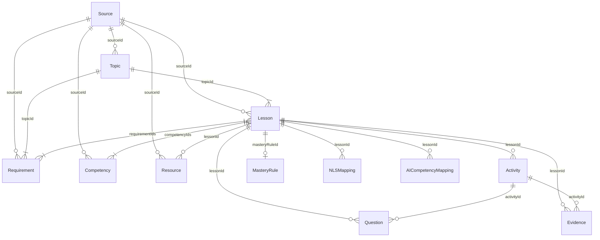

# PHASE 2 / TASK P2.5 — CURRICULUM DATA FOUNDATION SCHEMA SPECIFICATION (`PHASE2_SCHEMA.md`)

- **Phase / Task:** `PHASE 2 / TASK P2.5 ONLY`
- **Chuẩn JSON Schema:** Draft 2020-12 (`https://json-schema.org/draft/2020-12/schema`)
- **Phạm vi:** Data Foundation cho Chương trình Tin học Lớp 6 (GDPT 2018 – Thông tư 32/2018/TT-BGDĐT, SGK Kết nối tri thức với cuộc sống, Khung Năng lực số Thông tư 02/2025/TT-BGDĐT).
- **Trạng thái Production:** Không can thiệp UI, Learning Engine, Assessment Engine hay Google Sheets production.

---

## 1. Cấu trúc thư mục Data Foundation

```text
data/
  curriculum/
    sources-g6.json              # Danh mục nguồn chính thức (4 sources)
    topics-g6.json               # Chủ đề A–F lớp 6 (6 topics)
  requirements/
    requirements-g6.json         # Toàn bộ 32 YCCĐ G6-A-01 ... G6-F-03 kèm SHA-256 officialTextHash
  competencies/
    competencies-g6.json         # NLa–NLe + NLS 1.3.TC1a, 5.2.TC1a, 5.2.TC1b
    nls-mappings-g6.json         # Mapping NLS pilot cho Bài 3 (G6-L03)
    ai-mappings-g6.json          # Mapping NL AI tách biệt (mặc định [] – không tự chèn vào Requirement Bank)
  lessons/
    lessons-g6-ppct.json         # Phân phối chương trình 17 bài học lớp 6 (G6-L01 ... G6-L17)
    G6-L03.golden.json           # Golden Lesson fixture cho Bài 3 (Thông tin trong máy tính)
  resources/
    resources-g6.json            # Danh mục học liệu chuẩn hóa lớp 6

schemas/
  source.schema.json
  topic.schema.json
  lesson.schema.json
  requirement.schema.json
  competency.schema.json
  nls-mapping.schema.json
  ai-competency-mapping.schema.json
  activity.schema.json
  question.schema.json
  evidence.schema.json
  resource.schema.json
  mastery-rule.schema.json

tools/
  curriculum/
    validator.js                 # Bộ kiểm tra Schema + 10 quy tắc toàn vẹn dữ liệu & nghiệp vụ
    importer.js                  # Bộ nạp Idempotent + IntermediateCurriculumAdapter
    test-p2-5.js                 # Bộ kiểm thử tự động 20 kịch bản Phase 2 / P2.5
    staging-store.json           # Snapshot lưu trữ trung gian (không chạm production)
    fixtures/                    # 7 bộ test fixtures bắt buộc (valid & invalid)
```

---

## 2. Sơ đồ quan hệ thực thể (Entity-Relationship Overview)



---

## 3. Đặc tả chi tiết 12 JSON Schemas

| STT | Thực thể | File Schema | Primary Key | Foreign Keys / References | Ràng buộc cốt lõi |
| :--- | :--- | :--- | :--- | :--- | :--- |
| 1 | `Source` | [schemas/source.schema.json](file:///Users/huynhvandien/tinhocthaydien/schemas/source.schema.json) | `sourceId` | — | `sourceType` thuộc `curriculum_regulation`, `textbook`, `teacher_guide`, `workbook`, `digital_competency_framework`, `school_ppct`; `authorityLevel = mandatory \| official_reference \| school_approved`. |
| 2 | `Topic` | [schemas/topic.schema.json](file:///Users/huynhvandien/tinhocthaydien/schemas/topic.schema.json) | `topicId` (`^G6-[A-F]$`) | `sourceId` | Khối lớp `grade = 6`, mã chủ đề `code` thuộc `A`..`F`. |
| 3 | `Lesson` | [schemas/lesson.schema.json](file:///Users/huynhvandien/tinhocthaydien/schemas/lesson.schema.json) | `lessonId` (`^G6-L(0[1-9]\|1[0-7])$`) | `topicId`, `requirementIds[]`, `competencyIds[]`, `nlsCodes[]`, `activityIds[]`, `questionIds[]`, `evidenceIds[]`, `resourceIds[]`, `masteryRuleId`, `sourceId` | Nếu `status = "published"` bắt buộc `requirementIds` có ít nhất 1 phần tử (`PUBLISHED_LESSON_MISSING_REQUIREMENT`). |
| 4 | `Requirement` | [schemas/requirement.schema.json](file:///Users/huynhvandien/tinhocthaydien/schemas/requirement.schema.json) | `requirementId` (`^G6-[A-F]-[0-9]{2}$`) | `topicId`, `competencyIds[]`, `lessonIds[]`, `sourceId` | `officialText` được bảo vệ bằng `officialTextHash` (SHA-256, 64 kí tự hex), `version`, và `reviewStatus = "approved_official"`. Nghiêm cấm gắn mã NL AI vào `competencyIds`. |
| 5 | `Competency` | [schemas/competency.schema.json](file:///Users/huynhvandien/tinhocthaydien/schemas/competency.schema.json) | `competencyId` | `sourceId` | Hỗ trợ khung `GDPT2018_TINHOC` (`NLa`–`NLe`) và `NLS_2025` (`NLS-1.3.TC1a`, `NLS-5.2.TC1a`, `NLS-5.2.TC1b`). |
| 6 | `NLSMapping` | [schemas/nls-mapping.schema.json](file:///Users/huynhvandien/tinhocthaydien/schemas/nls-mapping.schema.json) | `mappingId` | `lessonId`, `requirementIds[]`, `competencyId`, `sourceId` | Liên kết tường minh giữa bài học, YCCĐ và chỉ báo Năng lực số (`1.3.TC1a`, `5.2.TC1a`, `5.2.TC1b`). |
| 7 | `AICompetencyMapping` | [schemas/ai-competency-mapping.schema.json](file:///Users/huynhvandien/tinhocthaydien/schemas/ai-competency-mapping.schema.json) | `aiMappingId` | `lessonId`, `requirementIds[]` | Tách biệt hoàn toàn khỏi Requirement Bank. Chỉ hợp lệ để publish khi `teacherApproved === true` (`UNAPPROVED_AI_MAPPING`). |
| 8 | `Activity` | [schemas/activity.schema.json](file:///Users/huynhvandien/tinhocthaydien/schemas/activity.schema.json) | `activityId` | `lessonId`, `requirementIds[]`, `evidenceIds[]`, `resourceIds[]` | FAIL nếu `requirementIds` rỗng VÀ `educationalPurposeApproved !== true` (`ACTIVITY_UNAPPROVED_WITHOUT_REQUIREMENTS`). |
| 9 | `Question` | [schemas/question.schema.json](file:///Users/huynhvandien/tinhocthaydien/schemas/question.schema.json) | `questionId` | `lessonId`, `activityId`, `requirementIds[]` | Bắt buộc có `requirementIds` không rỗng, `correctAnswer` không rỗng, và `explanation` không rỗng. |
| 10 | `Evidence` | [schemas/evidence.schema.json](file:///Users/huynhvandien/tinhocthaydien/schemas/evidence.schema.json) | `evidenceId` | `lessonId`, `activityId`, `requirementIds[]` | Xác định minh chứng đánh giá kết quả học tập theo YCCĐ và NLS. |
| 11 | `Resource` | [schemas/resource.schema.json](file:///Users/huynhvandien/tinhocthaydien/schemas/resource.schema.json) | `resourceId` | `lessonId`, `sourceId` | Nếu `requiresUrl = true` hoặc thuộc loại học liệu trực tuyến (`interactive_lesson`, `simulation`, `video`, `reference_doc`), trường `url` bắt buộc khác rỗng (`RESOURCE_MISSING_URL`). |
| 12 | `MasteryRule` | [schemas/mastery-rule.schema.json](file:///Users/huynhvandien/tinhocthaydien/schemas/mastery-rule.schema.json) | `masteryRuleId` | `lessonId`, `requiredActivityIds[]` | Quy định ngưỡng hoàn thành bài học (`minMasteryScorePercent`, `requireExitTicket`, `requirementThresholdCount`). |

---

## 4. Kết luận

```text
PHASE 2 / P2.5: PASS
```
