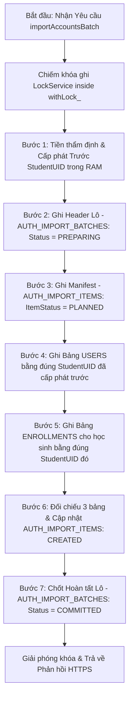
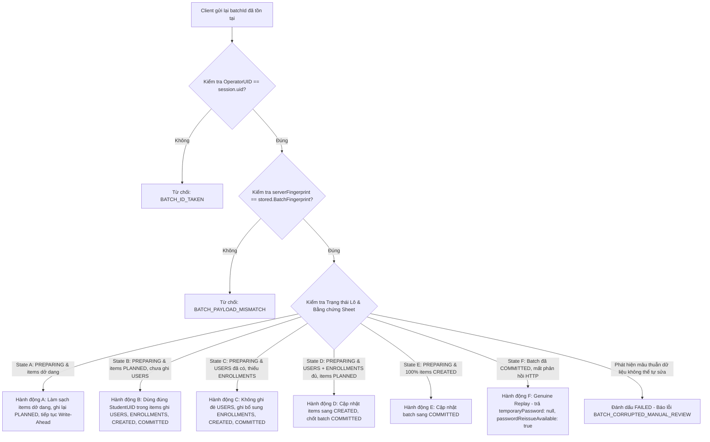

# ANTIGRAVITY EXECUTION REPORT

> File này do Antigravity cập nhật sau khi hoàn thành đợt rà soát và hiệu chỉnh thiết kế `AUTH-A1-R4: FINAL WRITE-AHEAD PROVENANCE CONSISTENCY FIX`.

---

# TASK ID: AUTH-A1-R4
**BRANCH:** `account-management-json-review`  
**BASE COMMIT:** `ecc56e274739078b431cf8fe294040a9cb6bacf5`  
**REVIEWED COMMIT:** `ba5e581`  
**TASK NAME:** Account Management Backend — Final Write-Ahead Provenance Consistency Fix  
**STATUS:** **`READY_FOR_REVIEW`**

---

## 1. TỔNG QUAN HIỆU CHỈNH THIẾT KẾ R4 (CORE ARCHITECTURAL FIX)

Đợt hiệu chỉnh thiết kế `AUTH-A1-R4` khép lại toàn bộ các thiếu sót và mâu thuẫn dữ liệu còn tồn tại trong thiết kế AUTH-A1-R3, tập trung vào 4 nội dung cốt lõi:

### 1.1. Bãi bỏ Thứ tự Ghi Cũ & Xác lập Cơ chế Write-Ahead Provenance (WAL)
- **Vấn đề của quy trình cũ:** Trình tự `USERS → ENROLLMENTS → AUTH_IMPORT_BATCHES(COMMITTED) → AUTH_IMPORT_ITEMS` tiềm ẩn lỗi nghiêm trọng vì ghi vào bảng nghiệp vụ trước khi có chứng cứ nguồn gốc bền vững. Nếu gián đoạn mạng hoặc timeout xảy ra sau khi ghi `USERS`, các tài khoản mồ côi được tạo ra mà máy chủ không thể chứng minh thuộc về lô nào. Quy trình cũ bị **BÃI BỎ HOÀN TOÀN**.
- **Quy trình Write-Ahead Provenance 7 bước nghiêm ngặt bên trong `withLock_`:**
  1. **Bước 1 (Thẩm định & Cấp phát Trước UID trong RAM):** Thẩm định cú pháp, kiểm tra quyền hạn theo bảng `TEACHER_ASSIGNMENTS` (`assignedSet_`), kiểm tra xung đột tài khoản với bảng `USERS`. Sinh trước danh sách `StudentUID` bất biến (`"stu_" + uuid_()`) cho 100% tài khoản trong RAM.
  2. **Bước 2 (Ghi Trước Header Lô - PREPARING):** Ghi một bản ghi vào `AUTH_IMPORT_BATCHES` với trạng thái `Status = "PREPARING"`, `CreatedCount = 0`, `ReplayedCount = 0`, `ExpiresAt = now + 24h`.
  3. **Bước 3 (Ghi Trước Danh mục Từng Mục - PLANNED):** Ghi toàn bộ danh sách tài khoản dự kiến tạo vào `AUTH_IMPORT_ITEMS` với trạng thái `ItemStatus = "PLANNED"`, gắn chặt với `StudentUID` đã cấp phát trước.
  4. **Bước 4 (Ghi Bảng USERS):** Chỉ sau khi chứng cứ nguồn gốc đã tồn tại bền vững trong `AUTH_IMPORT_BATCHES` và `AUTH_IMPORT_ITEMS`, máy chủ mới ghi các dòng mới vào `USERS` sử dụng đúng các `StudentUID` đã cấp phát trước.
  5. **Bước 5 (Ghi Bảng ENROLLMENTS):** Ghi các dòng tương ứng vào `ENROLLMENTS` (đối với học sinh) bằng đúng các `StudentUID` đó.
  6. **Bước 6 (Đối chiếu & Cập nhật Trạng thái Mục - CREATED):** Quét đối chiếu lại `USERS`, `ENROLLMENTS` và `AUTH_IMPORT_ITEMS`. Khi xác nhận các dòng đã tồn tại nhất quán, cập nhật các mục trong `AUTH_IMPORT_ITEMS` từ `"PLANNED"` sang `"CREATED"`.
  7. **Bước 7 (Chốt Hoàn tất Lô - COMMITTED):** Chỉ chuyển trạng thái của lô trong `AUTH_IMPORT_BATCHES` từ `"PREPARING"` sang `"COMMITTED"` khi 100% tài khoản được xác minh nhất quán.

---

## 2. MA TRẬN TÍNH NHẤT QUÁN PHỤC HỒI SỰ CỐ (FAILURE STATES A–F)

- **Bãi bỏ Logic Suy đoán (Heuristic Abolition):** Tuyệt đối không dùng logic suy đoán kiểu "tài khoản tạo trong 15 phút bởi cùng session" vì bảng `USERS` không lưu vết thời gian phiên hay session token.
- **Phục hồi Dựa trên Bằng chứng Máy chủ Tuyệt đối (States A–F):**

| Điểm Gián đoạn | Bằng chứng Máy chủ (Server Evidence) | Hành động Phục hồi (Recovery Action) | Cơ chế Chống Trùng lặp (Duplicate Prevention) |
|---|---|---|---|
| **Trường hợp A: Tạo batch PREPARING nhưng chưa ghi đủ manifest** | `AUTH_IMPORT_BATCHES` có `Status = "PREPARING"`, `AUTH_IMPORT_ITEMS` < `TotalAccounts`, bảng `USERS` chưa có tài khoản nào của lô | Máy chủ làm sạch các dòng dở dang trong `AUTH_IMPORT_ITEMS`, ghi lại đầy đủ manifest `PLANNED` với các `StudentUID` sinh trước, sau đó tiếp tục quy trình Write-Ahead. | Xóa sạch dòng dở dang; không bao giờ commit non khi chưa đủ manifest. |
| **Trường hợp B: Ghi manifest PLANNED nhưng chưa ghi USERS** | `AUTH_IMPORT_ITEMS` có đủ $N$ mục `"PLANNED"` với `StudentUID` đã cấp phát, bảng `USERS` chưa có các tài khoản này | Máy chủ đọc chính xác các `StudentUID` từ `AUTH_IMPORT_ITEMS` để ghi vào `USERS`, sau đó tiếp tục ghi `ENROLLMENTS`, cập nhật `"CREATED"` và chốt `"COMMITTED"`. | Tái sử dụng 100% `StudentUID` đã cấp phát; không sinh lại UID ngẫu nhiên mới. |
| **Trường hợp C: Đã ghi USERS nhưng thiếu ENROLLMENTS** | `AUTH_IMPORT_ITEMS` ở trạng thái `"PLANNED"`, `USERS` đã có đủ dòng với đúng `StudentUID`, nhưng `ENROLLMENTS` chưa có dòng | Không ghi lại `USERS`. Máy chủ thực hiện ghi bổ sung vào `ENROLLMENTS`, cập nhật `AUTH_IMPORT_ITEMS` sang `"CREATED"` và chốt batch sang `"COMMITTED"`. | Không chèn thêm dòng vào `USERS`; bảo toàn dữ liệu tài khoản đã tạo. |
| **Trường hợp D: Đã ghi USERS & ENROLLMENTS nhưng chưa cập nhật mục** | Cả `USERS` và `ENROLLMENTS` đã đầy đủ và khớp với manifest, nhưng `AUTH_IMPORT_ITEMS` vẫn là `"PLANNED"` | Máy chủ quét đối chiếu 3 bảng, cập nhật các mục trong `AUTH_IMPORT_ITEMS` sang `"CREATED"`, sau đó chuyển batch sang `"COMMITTED"`. | Không ghi thêm dòng vào `USERS` hay `ENROLLMENTS`. |
| **Trường hợp E: Đã CREATED nhưng chưa đánh dấu COMMITTED** | 100% mục trong `AUTH_IMPORT_ITEMS` đã là `"CREATED"`, nhưng `AUTH_IMPORT_BATCHES` vẫn là `"PREPARING"` | Máy chủ kiểm tra 100% mục đã hoàn tất, cập nhật `AUTH_IMPORT_BATCHES.Status = "COMMITTED"`. | Không tạo lại bất kỳ tài khoản nào; chốt hoàn tất chuyển đổi trạng thái lô. |
| **Trường hợp F: Đã COMMITTED nhưng mất phản hồi HTTP** | `AUTH_IMPORT_BATCHES.Status === "COMMITTED"` | Máy chủ xác nhận Replay hợp lệ, trả về kết quả với `temporaryPassword: null` và `passwordReissueAvailable: true` (tuân thủ Zero Cleartext). | Giữ nguyên toàn bộ Sheet, không sinh lại mật khẩu thô; giáo viên dùng `reissueBatchPasswords` nếu cần. |

### Điều kiện Từ chối Tự động & Xử lý Xung đột:
1. `OperatorUID !== session.uid` (và không phải admin) $\rightarrow$ Từ chối ngay với **`BATCH_ID_TAKEN`**.
2. `serverFingerprint !== stored.BatchFingerprint` $\rightarrow$ Từ chối ngay với **`BATCH_PAYLOAD_MISMATCH`**.
3. Tài khoản đã tồn tại trong `USERS` nhưng không nằm trong manifest `AUTH_IMPORT_ITEMS` của chính lô này $\rightarrow$ Từ chối ngay với **`COLLISION_EXISTING_ACCOUNT`**. Tuyệt đối không phỏng đoán theo thời gian.
4. Mâu thuẫn dữ liệu không thể tự sửa (ví dụ `StudentUID` trong manifest trùng với học sinh khác đã tồn tại từ trước) $\rightarrow$ Đánh dấu batch là `"FAILED"` và trả mã lỗi **`BATCH_CORRUPTED_MANUAL_REVIEW`** để đối chiếu thủ công.
5. Tài khoản đã đổi mật khẩu hoặc đã có bài làm trong `RESPONSES` $\rightarrow$ Từ chối reset hàng loạt với **`STUDENT_ALREADY_ACTIVE`**.

---

## 3. CÁC HIỆU CHỈNH ĐỒNG BỘ TOÀN BỘ TÀI LIỆU (DOCUMENT CONSISTENCY FIXES)

1. **Chuẩn hóa Định dạng `batchId` Toàn hệ thống:**
   - Quy chuẩn thống nhất định dạng duy nhất: **`^bat_[0-9a-f]{32}$`** (ví dụ: `"bat_c0a80101e5f67890123456789abcdef0"`), đồng bộ với quy ước `uuid_()` của backend (`Code.gs:314`).
   - Đã loại bỏ hoàn toàn các chuỗi mẫu cũ không khớp quy cách (như `batch_20261025_6A1_001` hay `bat_test_01`).
2. **Loại bỏ Chuỗi Băm Rỗng & Tính Toán Băm Chuẩn tắc Thực tế:**
   - Đã loại bỏ chuỗi băm rỗng `e3b0c44298fc1c149afbf4c8996fb92427ae41e4649b934ca495991b7852b855` (vốn là `sha256("")`).
   - Thay thế bằng chuỗi băm SHA-256 thực tế được tính toán chuẩn tắc:
     + Payload mẫu 2 tài khoản (`6A1-01`, `6A1-02`): **`0d2ffbcbde865ffc67c2a815f6d2aeb7b1efffd4082918e5cdb6c6f1072086af`**
     + Payload mẫu 4 tài khoản (`6A1-01` $\rightarrow$ `6A1-04`): **`c1daae96748a1c2af1858a9db84ef2e43197839ac51e71d13198db450346992b`**
3. **Đồng bộ Hóa Test Vector 29:**
   - Khẳng định rõ máy chủ tự chuẩn hóa Canonical JSON và tính `batchFingerprint` độc quyền; bỏ qua hoàn toàn giá trị băm do client khai báo.
4. **Loại bỏ Tuyên bố Chưa Đo lường "< 20 giây":**
   - Đã xóa bỏ khẳng định "< 20 giây CPU" chưa được đo lường thực tế, thay bằng ràng buộc kỹ thuật chuẩn xác: "đảm bảo thời gian chạy nằm an toàn trong giới hạn quota thực thi của Google Apps Script".
5. **Thống nhất Vòng đời Trạng thái:**
   - `AUTH_IMPORT_BATCHES.Status`: `"PREPARING"` $\rightarrow$ `"COMMITTED"` (hoặc `"FAILED"` / `"EXPIRED"`).
   - `AUTH_IMPORT_ITEMS.ItemStatus`: `"PLANNED"` $\rightarrow$ `"CREATED"` (hoặc `"REPLAYED"`).
6. **Mở rộng Bộ Kiểm thử Chấp nhận lên 50 Test Vectors:**
   - Đã bổ sung Nhóm 8 (Test Vectors 45–50) mô phỏng chính xác các điểm gián đoạn từ Điểm A đến Điểm F, kiểm tra việc máy chủ không commit non và tự hàn gắn dữ liệu nhất quán.

---

## 4. BẢO TOÀN RANH GIỚI VÀ QUẢN TRỊ AN NINH (BOUNDARIES & GOVERNANCE)

1. **Tuân thủ Tuyệt đối Ranh giới Không Can thiệp Mã nguồn:**
   - **0% can thiệp mã nguồn backend:** Không chỉnh sửa bất kỳ tệp `.gs` nào (`backend/Code.gs`, `backend/Teacher.gs`, `backend/StudentV2.gs`).
   - **0% can thiệp mã nguồn frontend:** Không chỉnh sửa bất kỳ tệp `.js` nào (`assets/js/auth.js`, `assets/js/teacher.js`).
   - **0% thay đổi dữ liệu sản xuất:** Không chạm vào bảng tính Google Sheets của trường học.
   - Chỉ chỉnh sửa 4 tệp tài liệu trong `docs/auth/` và tệp báo cáo `agent/AGENT_REPORT.md`.
2. **Duy trì Trạng thái An ninh PBKDF2:**
   - Giữ nguyên quyết định duy trì baseline 1.000 iterations ở trạng thái: **`SECURITY_RISK_ACCEPTED: PENDING_HUMAN_APPROVAL`**.
3. **Nguyên tắc Không Lưu Trữ Mật Khẩu Bản Rõ (Zero Cleartext Persistence):**
   - Không lưu trữ mật khẩu rõ, mật khẩu tạm, hash hay token trong `AUTH_IMPORT_BATCHES` và `AUTH_IMPORT_ITEMS`.
   - Khi Replay, máy chủ trả về `temporaryPassword: null` và `passwordReissueAvailable: true`, tuyệt đối không gửi lại mật khẩu cũ.

---

## 5. DANH MỤC CÁC TỆP ĐÃ HIỆU CHỈNH TRÊN NHÁNH REVIEW

1. [`docs/auth/account-import-schema-v1.md`](file:///Users/huynhvandien/tinhocthaydien/docs/auth/account-import-schema-v1.md):
   - Cập nhật Mục 7.2: Đặc tả cơ chế Write-Ahead Provenance 7 bước, chuẩn hóa `batchId` regex `^bat_[0-9a-f]{32}$`, băm SHA-256 thực tế, vòng đời trạng thái lô và items, quy tắc phục hồi an toàn States A–F.
2. [`docs/auth/account-api-contract-v1.md`](file:///Users/huynhvandien/tinhocthaydien/docs/auth/account-api-contract-v1.md):
   - Cập nhật Mục 2: Thêm mã lỗi `BATCH_CORRUPTED_MANUAL_REVIEW`.
   - Cập nhật Mục 3.3 (`importAccountsBatch`): Quy trình Write-Ahead Provenance WAL, bỏ tuyên bố "< 20 giây", bỏ heuristic "15 phút", cập nhật payload mẫu chuẩn hóa `batchId` và `batchFingerprint`.
   - Cập nhật Mục 3.4 (`reissueBatchPasswords`): Đồng bộ `batchId` sang định dạng chuẩn `^bat_[0-9a-f]{32}$`.
3. [`docs/auth/account-security-review.md`](file:///Users/huynhvandien/tinhocthaydien/docs/auth/account-security-review.md):
   - Cập nhật Mục 3.3 & 3.4: Phân tích an ninh cơ chế Write-Ahead Provenance, Ma trận phục hồi States A–F, các điều kiện tự động từ chối.
4. [`docs/auth/account-test-plan.md`](file:///Users/huynhvandien/tinhocthaydien/docs/auth/account-test-plan.md):
   - Cập nhật Mục 1.1 & Mục 2: Bổ sung Nhóm 8, nâng tổng số test vectors lên **50 Test Vectors**.
   - Cập nhật Test Vector 29: Máy chủ băm độc quyền, bỏ qua hash của client.
   - Cập nhật Test Vector 39: Bãi bỏ heuristic phỏng đoán 15 phút, bắt buộc từ chối khi không có chứng cứ nguồn gốc trước.
   - Bổ sung Test Vectors 45–50: Kiểm thử phục hồi chi tiết tại các Điểm Gián đoạn A, B, C, D, E, F.
5. [`agent/AGENT_REPORT.md`](file:///Users/huynhvandien/tinhocthaydien/agent/AGENT_REPORT.md):
   - Báo cáo toàn diện đợt hiệu chỉnh thiết kế `AUTH-A1-R4` với hai biểu đồ Mermaid trực quan.

---

## 6. CÁC QUYẾT ĐỊNH CHỜ CẤP CÓ THẨM QUYỀN PHÊ DUYỆT (PENDING APPROVAL DECISIONS)

1. **Phê duyệt Cơ chế Write-Ahead Provenance (WAL) & Trật tự Ghi 7 Bước:**
   - Phê duyệt trình tự ghi bắt buộc `AUTH_IMPORT_BATCHES: PREPARING` $\rightarrow$ `AUTH_IMPORT_ITEMS: PLANNED` $\rightarrow$ `USERS` $\rightarrow$ `ENROLLMENTS` $\rightarrow$ `CREATED` $\rightarrow$ `COMMITTED` và cơ chế phục hồi States A–F.
2. **Phê duyệt 2 Bảng Metadata Nguồn gốc Lô (`PROPOSED_CHANGE — PENDING_HUMAN_APPROVAL`):**
   - Phê duyệt cấu trúc 12 cột của `AUTH_IMPORT_BATCHES` và 7 cột của `AUTH_IMPORT_ITEMS`.
3. **Chấp thuận Rủi ro Bảo mật PBKDF2 1.000 Vòng lặp (`SECURITY_RISK_ACCEPTED: PENDING_HUMAN_APPROVAL`):**
   - Phê duyệt việc duy trì tạm thời mức `pbkdf2Iterations: 1000` trên Google Apps Script, kèm lộ trình nâng cấp tương thích ngược khi có điều kiện.

---

# FINAL STATUS: READY_FOR_REVIEW

> Toàn bộ các yêu cầu hiệu chỉnh thiết kế của **`AUTH-A1-R4`** đã được hoàn tất triệt để, chuẩn hóa đầy đủ trong thư mục `docs/auth/` và `agent/AGENT_REPORT.md`.  
> Hệ thống tuân thủ triệt để nguyên tắc an toàn: **DỪNG LẠI và CHỜ PHÊ DUYỆT (STOP)**. Tuyệt đối không tự ý bắt đầu triển khai mã nguồn backend `AUTH-A1` hay task giao diện `AUTH-A2`.
