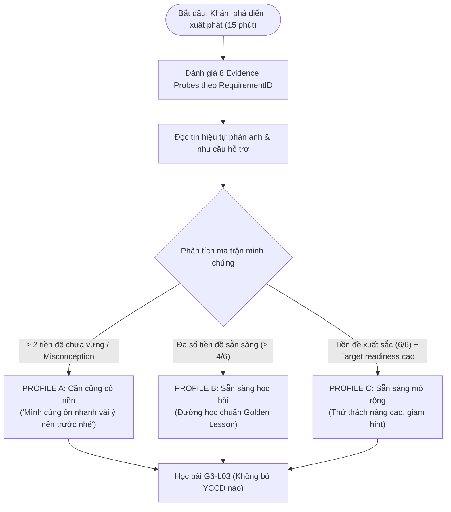

# ĐẶC TẢ CHẨN ĐOÁN HỌC TẬP (DIAGNOSTIC SPECIFICATION)
## "KHÁM PHÁ ĐIỂM XUẤT PHÁT" — G6-L03
### TÀI LIỆU THIẾT KẾ PHASE 4A (P4.1) — DESIGN ONLY / NO ENGINE CODE

> **Mã tài liệu:** `DOC-P4-DIAG-SPEC-01`  
> **Trạng thái:** `PROPOSAL_DESIGN` (Chỉ dùng cho đặc tả thiết kế, chưa triển khai mã nguồn Engine)  
> **Áp dụng cho:** Bài học mẫu `G6-L03` (*Bài 3. Thông tin trong máy tính* — 2 tiết / 90 phút)  
> **Căn cứ nguồn chuẩn:** [requirements-g6.json](file:///Users/huynhvandien/tinhocthaydien/data/requirements/requirements-g6.json), [G6-L03.golden.json](file:///Users/huynhvandien/tinhocthaydien/data/lessons/G6-L03.golden.json), [PHASE3_TRACEABILITY_REPORT.md](file:///Users/huynhvandien/tinhocthaydien/PHASE3_TRACEABILITY_REPORT.md).

---

## 1. MỤC TIÊU & NGUYÊN TẮC SƯ PHẠM

### 1.1. Tên gọi thân thiện với học sinh (Student-Facing Title)
- **Tên gọi chính thức:** **"Khám phá điểm xuất phát"**
- **Thông điệp sư phạm gửi đến học sinh:**
  > *"Trước khi bước vào hành trình thú vị về thế giới số, chúng mình cùng dành ít phút khám phá xem em đã mang theo những hành trang nào và cần thầy cô hỗ trợ phần nào nhé!"*
- **Quy tắc cấm kỵ (Non-negotiable terminology constraints):**
  - **TUYỆT ĐỐI KHÔNG GỌI:** "Thi đầu vào", "Kiểm tra đầu vào", "Khảo sát chất lượng", "Xếp loại học sinh", "Bài test phân loại".
  - **TUYỆT ĐỐI KHÔNG DÙNG TỪ TIÊU CỰC:** "yếu", "kém", "mất gốc", "chậm tiến", "thiếu hụt trầm trọng".

### 1.2. Mục đích cốt lõi
1. **Xác định hành trang thực tế (Evidence Inventory):** Thu thập minh chứng về kiến thức và kỹ năng nền tảng mà học sinh đã tích lũy từ Chủ đề A (Bài 1, Bài 2) hoặc trải nghiệm số đời sống.
2. **Nhận diện nhu cầu hỗ trợ (Support Identification):** Nhận biết những quan niệm chưa chính xác (misconceptions) và mức độ hỗ trợ mà học sinh mong muốn nhận được khi gặp bài khó.
3. **Cá nhân hóa khởi đầu học tập (Adaptive Starting Path):** Đề xuất một trong 3 cấu hình học tập (Profiles) tối ưu hóa thang hỗ trợ (Support Ladder) và thứ tự gợi ý trong `G6-L03`.

### 1.3. Những điều không thuộc mục tiêu (Non-goals)
- **Không nhằm lấy điểm số:** Kết quả chẩn đoán không được ghi vào sổ điểm, không tính vào điểm tổng kết hay đánh giá định kỳ.
- **Không dán nhãn năng lực:** Không dùng để phân chia học sinh thành các nhóm cố định hay phân biệt đối xử trong lớp học.
- **Không kết luận Mastery chính thức:** Hoạt động chẩn đoán chỉ tạo **trạng thái minh chứng giả định ban đầu (tentative evidence state)**, **TUYỆT ĐỐI KHÔNG** được cấp mức `🌳 Đạt yêu cầu` (`meets_requirement`) hay `🚀 Vận dụng mở rộng` (`transfer_extension`) cho các YCCĐ chính thức của bài học.
- **Không miễn trừ YCCĐ:** Dù học sinh có hiểu biết trước bài học, học sinh vẫn phải tham gia đầy đủ các hoạt động học tập cốt lõi của `G6-L03` để tạo minh chứng hoàn chỉnh.

---

## 2. THỜI LƯỢNG & PHÂN BỔ DÒNG CHẢY (15-MINUTE FLOW)

Tổng thời gian thực hiện tối đa: **15 phút** (thiết kế tinh gọn, vừa sức, không gây áp lực tâm lý hay mệt mỏi cho học sinh lớp 6).

| Phân đoạn | Thời lượng | Nội dung hoạt động | Mục tiêu thu thập minh chứng |
|---|---|---|---|
| **Khởi động & Chào đón** | 1 phút | Lời chào của Thầy Diễn, giải thích ý nghĩa hoạt động khám phá, tạo tâm lý thoải mái. | Xóa bỏ rào cản sợ kiểm tra, kích hoạt tinh thần tự tin. |
| **Phần 1: Hành trang nền tảng** | 5–6 phút | **5 probes (Nhóm A & Nhóm B)**: Tình huống thực tế về thông tin, dữ liệu và xử lí thông tin. | Thu thập minh chứng tiền đề cho `G6-A-01` đến `G6-A-06`. |
| **Phần 2: Thăm dò vùng sẵn sàng** | 4–5 phút | **3 probes (Nhóm C)**: Tình huống nhận diện ban đầu về bit, ký hiệu 0–1, dung lượng KB/MB/GB và thiết bị nhớ. | Thăm dò độ nhạy cảm ban đầu (Readiness signals) cho `G6-A-07` đến `G6-A-10`. |
| **Phần 3: Tự phản ánh & Nhu cầu** | 2–3 phút | **2 câu hỏi phản ánh (Reflection prompts)**: Thói quen nhận hỗ trợ và mức độ tự tin. | Tín hiệu bổ trợ (Auxiliary signals) để định hình mức độ gợi ý của Support Ladder. |
| **Tổng cộng** | **Tối đa 15 phút** | **8 Evidence Probes + 2 Self-report Prompts** | **Đầy đủ dữ liệu để ánh xạ Profile học tập.** |

---

## 3. PHẠM VI YÊU CẦU CẦN ĐẠT (REQUIREMENT COVERAGE)

### 3.1. Prerequisite Requirements (YCCĐ Tiền đề từ Chủ đề A — Đã duyệt trong Requirement Bank)
Dữ liệu tiền đề bắt buộc đọc nguyên văn từ [requirements-g6.json](file:///Users/huynhvandien/tinhocthaydien/data/requirements/requirements-g6.json):

1. **`G6-A-01`** (Bài 1): *Phân biệt được thông tin với vật mang tin.*
2. **`G6-A-02`** (Bài 1): *Nhận biết được sự khác nhau giữa thông tin và dữ liệu.*
3. **`G6-A-03`** (Bài 1): *Nêu được ví dụ minh hoạ mối quan hệ giữa thông tin và dữ liệu.*
4. **`G6-A-04`** (Bài 1): *Nêu được ví dụ minh hoạ tầm quan trọng của thông tin.*
5. **`G6-A-05`** (Bài 2): *Giải thích được máy tính là công cụ hiệu quả để thu thập, lưu trữ, xử lí và truyền thông tin. Nêu được ví dụ minh hoạ cụ thể.*
6. **`G6-A-06`** (Bài 2): *Nêu được các bước cơ bản trong xử lí thông tin.*

### 3.2. Target Readiness Preview (YCCĐ Đích của Bài 3 — Chỉ thăm dò mức độ sẵn sàng)
1. **`G6-A-07`** (Bài 3): *Giải thích được có thể biểu diễn thông tin chỉ với hai kí hiệu 0 và 1.*
2. **`G6-A-08`** (Bài 3): *Biết được bit là đơn vị nhỏ nhất trong lưu trữ thông tin.*
3. **`G6-A-09`** (Bài 3): *Nêu được tên và độ lớn (xấp xỉ theo hệ thập phân) của các đơn vị cơ bản đo dung lượng thông tin: Byte, KB, MB, GB, quy đổi được một cách gần đúng giữa các đơn vị đo lường này. Ví dụ: 1 KB bằng xấp xỉ 1 ngàn byte, 1 MB xấp xỉ 1 triệu byte, 1 GB xấp xỉ 1 tỉ byte.*
4. **`G6-A-10`** (Bài 3): *Nêu được sơ lược khả năng lưu trữ của các thiết bị nhớ thông dụng như đĩa cứng, USB, CD, thẻ nhớ,...*

---

## 4. CHI TIẾT BẢN THIẾT KẾ 8 EVIDENCE PROBES

### 4.1. Nhóm A — Thông tin và dữ liệu (Coverage: `G6-A-01` .. `G6-A-04`)

#### Probe 1 (`DIAG-PROBE-01`)
- **Mã YCCĐ mục tiêu:** `G6-A-01` (*Phân biệt được thông tin với vật mang tin*)
- **Dạng thức:** Scenario MCQ kết hợp phân loại trực quan (Visual Classification).
- **Ngữ cảnh thực tế:** *"Bạn Lan nhận được một bức thư báo thời tiết từ cô giáo chủ nhiệm được in trên một tờ giấy màu xanh."*
- **Nhiệm vụ của học sinh:** Xác định trong tình huống trên, đâu là **vật mang tin** và đâu là **thông tin**.
  - Tùy chọn A: Tờ giấy màu xanh là vật mang tin; nội dung dự báo thời tiết là thông tin. *(Đáp án chuẩn)*
  - Tùy chọn B: Tờ giấy màu xanh là thông tin; chữ in trên giấy là vật mang tin.
  - Tùy chọn C: Cả tờ giấy và chữ in đều là thông tin.
  - Tùy chọn D: Tờ giấy và chữ in đều là vật mang tin, không có thông tin.
- **Tín hiệu đánh giá (Evidence Signal):**
  - Đúng: Nắm chắc sự khác biệt giữa phương tiện chứa đựng vật lý và nội dung hiểu biết thu nhận được (`ready_evidence`).
  - Chọn B hoặc C: Nhầm lẫn giữa phương tiện vật lý và ý nghĩa tri thức (`emerging_evidence`).

#### Probe 2 (`DIAG-PROBE-02`)
- **Mã YCCĐ mục tiêu:** `G6-A-02`, `G6-A-03` (*Khác nhau và mối quan hệ giữa thông tin và dữ liệu*)
- **Dạng thức:** Scenario Short Matching / Phân tích dữ liệu học đường.
- **Ngữ cảnh thực tế:** *"Trên thẻ học sinh của bạn Minh có ghi dòng chữ: 'Lớp: 6A1, Năm sinh: 2014, Chiều cao: 145 cm'."*
- **Nhiệm vụ của học sinh:** Nối hoặc chọn phát biểu đúng về mối quan hệ giữa dữ liệu và thông tin:
  - *"Dòng chữ và các con số in trên thẻ là dữ liệu; hiểu biết 'Minh là học sinh lớp 6A1 và cao 145 cm' là thông tin."* *(Đáp án chuẩn)*
- **Tín hiệu đánh giá (Evidence Signal):**
  - Hiểu được dữ liệu là các ký hiệu/con số/chữ viết được ghi lại, còn thông tin là ý nghĩa hiểu biết rút ra sau khi đọc dữ liệu (`ready_evidence`).

#### Probe 3 (`DIAG-PROBE-03`)
- **Mã YCCĐ mục tiêu:** `G6-A-04` (*Ví dụ minh hoạ tầm quan trọng của thông tin*)
- **Dạng thức:** Tình huống ra quyết định (Decision-making scenario).
- **Ngữ cảnh thực tế:** *"Lớp 6A chuẩn bị đi dã ngoại ngoài trời. Buổi sáng trước khi xuất phát, bạn lớp trưởng nghe đài báo: 'Chiều nay trời sẽ có mưa dông rất to'."*
- **Nhiệm vụ của học sinh:** Lựa chọn hành động hợp lí nhất và giải thích ngắn gọn vì sao thông tin đó quan trọng.
  - Hành động: Lớp trưởng thông báo cho các bạn mang theo áo mưa và chuẩn bị phương án sinh hoạt trong nhà.
- **Tín hiệu đánh giá (Evidence Signal):**
  - Thấy được thông tin đúng và kịp thời giúp con người thay đổi hành vi và đưa ra quyết định an toàn, hiệu quả (`ready_evidence`).

---

### 4.2. Nhóm B — Xử lí thông tin (Coverage: `G6-A-05`, `G6-A-06`)

#### Probe 4 (`DIAG-PROBE-04`)
- **Mã YCCĐ mục tiêu:** `G6-A-06` (*Các bước cơ bản trong xử lí thông tin*)
- **Dạng thức:** Sắp xếp trình tự thao tác (Drag-and-drop / Number ordering).
- **Ngữ cảnh thực tế:** *"Một bạn học sinh nghe tiếng trống trường điểm giờ vào lớp, bạn ghi nhớ thời gian, suy nghĩ cần về phòng học nào và nhanh chóng bước chân về lớp học đó."*
- **Nhiệm vụ của học sinh:** Kéo thả 4 mảnh ghép vào đúng trình tự 4 bước:
  1. **Thu nhận thông tin** *(tai nghe thấy tiếng trống)*
  2. **Lưu trữ thông tin** *(bộ não ghi nhớ tín hiệu)*
  3. **Xử lí thông tin** *(não suy nghĩ xác định phòng học)*
  4. **Truyền thông tin** *(báo cho bạn cùng đi hoặc cơ thể hành động)*
- **Tín hiệu đánh giá (Evidence Signal):**
  - Sắp xếp chuẩn xác 100%: Nắm vững quy trình xử lí thông tin tự nhiên và trong hệ thống (`ready_evidence`).
  - Nhầm lẫn giữa Xử lí và Lưu trữ: Cần củng cố trực quan ở khâu xử lí dữ liệu (`emerging_evidence`).

#### Probe 5 (`DIAG-PROBE-05`)
- **Mã YCCĐ mục tiêu:** `G6-A-05` (*Máy tính là công cụ hiệu quả trong xử lí thông tin*)
- **Dạng thức:** Scenario MCQ đa khía cạnh.
- **Ngữ cảnh thực tế:** *"Để làm một bài thuyết trình về danh lam thắng cảnh quê hương, máy tính hỗ trợ em hiệu quả nhất ở những khâu nào?"*
- **Nhiệm vụ của học sinh:** Chọn phương án thể hiện toàn diện năng lực của máy tính:
  - Phương án: Thu thập hình ảnh từ Internet, lưu trữ hàng trăm bức ảnh vào thư mục, chỉnh sửa văn bản giới thiệu và gửi bài trình chiếu qua email cho thầy cô. *(Đủ 4 khâu: Thu nhận - Lưu trữ - Xử lí - Truyền)*
- **Tín hiệu đánh giá (Evidence Signal):**
  - Nhận diện máy tính không chỉ là máy tính toán số học mà là công cụ đa năng cho toàn bộ vòng đời thông tin (`ready_evidence`).

---

### 4.3. Nhóm C — Thăm dò vùng sẵn sàng (Target Readiness Preview: `G6-A-07` .. `G6-A-10`)
> **Nguyên tắc vàng:** Nhóm C chỉ dùng để nhận biết học sinh thuộc trạng thái: *đã từng nghe/biết*, *biết một phần*, hay *hoàn toàn mới mẻ*. **TUYỆT ĐỐI KHÔNG** dùng kết quả nhóm này để đánh giá Mastery của Bài 3.

#### Probe 6 (`DIAG-PROBE-06`)
- **Mã YCCĐ thăm dò:** `G6-A-07`, `G6-A-08` (*Biểu diễn 0–1 và khái niệm bit*)
- **Dạng thức:** Khảo sát nhận diện khái niệm mở (Gentle Awareness Probe).
- **Câu hỏi:** *"Em có biết bên trong máy tính, mọi hình ảnh, con số và bài hát được lưu trữ dưới dạng những kí hiệu nào không?"*
  - Tùy chọn 1: Em đã từng nghe máy tính dùng các dãy chỉ gồm hai số 0 và 1 (hoặc bit). *(Tín hiệu: Đã có khái niệm sơ khởi)*
  - Tùy chọn 2: Em nghĩ máy tính lưu trực tiếp chữ viết và màu sắc giống hệt như mắt người nhìn thấy. *(Tín hiệu: Quan niệm trực quan tự nhiên)*
  - Tùy chọn 3: Em chưa từng nghe về điều này và rất tò mò muốn khám phá. *(Tín hiệu: Khởi đầu mới)*
- **Xử lý kết quả:** Không chấm đúng/sai tính điểm; dùng để thiết lập mức độ ngạc nhiên sư phạm (pedagogical hook) ở Hoạt động A01/A02.

#### Probe 7 (`DIAG-PROBE-07`)
- **Mã YCCĐ thăm dò:** `G6-A-09` (*Đơn vị đo dung lượng KB, MB, GB*)
- **Dạng thức:** Tình huống đời sống thường gặp (Everyday digital life).
- **Câu hỏi:** *"Khi xem thông số một gói cước mạng Internet trên điện thoại ghi 'Dung lượng 4 GB/ngày', hoặc tải một bài hát ghi 'Kích thước 5 MB', em hiểu các chữ cái MB, GB biểu thị điều gì?"*
  - Tùy chọn 1: Đó là các đơn vị đo dung lượng (độ lớn) của thông tin trong thiết bị số.
  - Tùy chọn 2: Đó là đơn vị đo tốc độ chạy nhanh hay chậm của máy bay hoặc ô tô.
  - Tùy chọn 3: Em thường thấy trên màn hình nhưng chưa rõ ý nghĩa cụ thể.
- **Xử lý kết quả:** Nhận biết học sinh đã quen thuộc với ký hiệu đơn vị hay cần giới thiệu thang đo trực quan từ đầu ở A05.

#### Probe 8 (`DIAG-PROBE-08`)
- **Mã YCCĐ thăm dò:** `G6-A-10` (*Thiết bị nhớ thông dụng*)
- **Dạng thức:** Ghép nối hình ảnh thiết bị thực tế.
- **Câu hỏi:** *"Em hãy ghép tên các thiết bị lưu trữ sau với hình ảnh quen thuộc: Thẻ nhớ máy ảnh, Ổ cứng máy tính, USB bỏ túi."*
- **Xử lý kết quả:** Đo lường trải nghiệm thực tế với phần cứng lưu trữ để định hướng chế độ `REAL_DEVICE` hay `SIMULATION` ở Hoạt động A07.

---

## 5. THIẾT KẾ 2 CÂU HỎI TỰ PHẢN ÁNH (REFLECTION PROMPTS)

### Prompt 1 (`DIAG-SELF-01`): Phong cách & Nhu cầu hỗ trợ
- **Câu hỏi:** *"Khi làm một nhiệm vụ học tập mới mẻ hoặc gặp câu hỏi khó, em thích nhận được sự hỗ trợ theo cách nào nhất?"*
  - **Mức A (Độc lập):** *"Em muốn tự mình mày mò suy nghĩ trước, chỉ cần một gợi ý nhỏ (Hint) khi thật sự chưa tìm ra cách."*
  - **Mức B (Trực quan):** *"Em muốn nhìn thấy một hình ảnh minh họa hoặc ví dụ tương tự để tự làm theo."*
  - **Mức C (Đồng hành):** *"Em muốn được hướng dẫn từng bước nhỏ kèm bài mẫu chi tiết để chắc chắn mình làm đúng."*
- **Ý nghĩa cấu hình:**
  - Chọn A: Ưu tiên đường dẫn thử thách, Support Ladder ẩn ban đầu.
  - Chọn B: Kích hoạt gợi ý Tier 1 trực quan ngay từ đầu.
  - Chọn C: Đưa vào Profile A, tự động mở sẵn các nấc hỗ trợ từng bước.

### Prompt 2 (`DIAG-SELF-02`): Mức độ tự tin ban đầu
- **Câu hỏi:** *"Bước vào bài học 'Thông tin trong máy tính' hôm nay, em cảm thấy thế nào?"*
  - Tùy chọn 1: Rất hào hứng và tự tin vì em yêu thích công nghệ.
  - Tùy chọn 2: Cảm thấy bình thường, sẵn sàng học cùng các bạn.
  - Tùy chọn 3: Hơi lo lắng một chút vì sợ máy tính phức tạp.
- **Quy tắc bảo vệ dữ liệu:**
  - Tín hiệu tự phản ánh chỉ được lưu trữ nội bộ để gợi ý tâm lý sư phạm.
  - **TUYỆT ĐỐI KHÔNG** dùng để xếp loại học lực hay thay thế kết quả làm bài của học sinh.

---

## 6. NGUYÊN TẮC KHÔNG DÙNG TỔNG ĐIỂM DUY NHẤT (ANTI-REDUCTIONISM)

Hệ thống **TUYỆT ĐỐI NGHIÊM CẤM** việc cộng gộp kết quả chẩn đoán thành một điểm số số học duy nhất dạng:
- `"7/10 điểm"`
- `"70%"`
- `"Xếp loại: Khá / Trung bình / Yếu"`

### Lý do sư phạm:
1. Hai học sinh cùng đạt 5/8 câu đúng có thể có cấu trúc năng lực hoàn toàn khác nhau:
   - Học sinh 1: Vững chắc về thông tin/dữ liệu (`G6-A-01`..`04`) nhưng chưa rõ về xử lí (`G6-A-05`..`06`).
   - Học sinh 2: Nắm được quy trình xử lí nhưng lại nhầm lẫn khái niệm cơ bản giữa vật mang tin và thông tin.
2. Việc quy về một con số trung bình làm lu mờ (masking) chính xác nhu cầu sư phạm cần hỗ trợ.
3. Thay vào đó, kết quả chẩn đoán được xuất dưới dạng **Hồ sơ minh chứng đa chiều (Multi-dimensional Evidence Inventory)** theo từng `RequirementID`.

---

## 7. CÁC TRẠNG THÁI MINH CHỨNG CHẨN ĐOÁN (DIAGNOSTIC EVIDENCE STATUS)

Sau khi hoàn thành 8 probes, mỗi RequirementID được gán một trong 4 trạng thái khởi điểm:

| Mã trạng thái máy | Tên hiển thị sư phạm | Định nghĩa & Ý nghĩa kỹ thuật |
|---|---|---|
| `no_evidence` | **Chưa có dữ liệu** | Học sinh chưa trả lời probe liên quan hoặc bỏ qua, hệ thống chưa đủ căn cứ để suy luận. |
| `emerging_evidence` | **Minh chứng đang hình thành** | Học sinh trả lời đúng một phần, hoặc trả lời sai ở khía cạnh bản chất, hoặc bộc lộ quan niệm sai lệch (misconception) cần làm rõ. |
| `ready_evidence` | **Minh chứng sẵn sàng** | Học sinh hoàn thành chính xác probe tiền đề với lập luận logic vững vàng; sẵn sàng tiếp thu bài học mới với scaffold tiêu chuẩn. |
| `conflicting_evidence` | **Minh chứng mâu thuẫn** | Kết quả giữa các probe trong cùng một nhóm chủ đề đối nghịch nhau (ví dụ: giải thích đúng khái niệm nhưng khi vào tình huống thực tế lại chọn ngược lại). Cần bổ sung câu hỏi làm rõ. |

> **Lưu ý đặc biệt:** 4 trạng thái trên **CHỈ LÀ TRẠNG THÁI KHỞI ĐIỂM (TENTATIVE STARTING STATUS)** của khâu chẩn đoán. Chúng hoàn toàn tách biệt với 4 mức độ **Mastery Model chính thức** (`insufficient_evidence`, `developing`, `meets_requirement`, `transfer_extension`) của Phase 4.2.

---

## 8. BA HỒ SƠ LỘ TRÌNH HỌC TẬP (3 LEARNING PATH PROFILES)

Dựa trên Hồ sơ minh chứng đa chiều, hệ thống đề xuất một trong 3 cấu hình lộ trình:



### 8.1. PROFILE A — "Cần củng cố nền" (`foundation_consolidation`)
- **Điều kiện kích hoạt:**
  - Có từ 2 YCCĐ tiền đề (`G6-A-01` .. `G6-A-06`) ở trạng thái `no_evidence` hoặc `emerging_evidence`.
  - Hoặc bộc lộ quan niệm sai lầm cốt lõi ở Probe 1 / Probe 4.
  - Hoặc học sinh chủ động chọn nhu cầu hỗ trợ từng bước (`DIAG-SELF-01 = C`).
- **Cấu hình can thiệp sư phạm:**
  - **Micro-review (Ôn tập tức thời):** Bổ sung 1 thẻ tóm tắt trực quan 2 phút trước khi vào bài: Sơ đồ phân biệt vật mang tin vs. thông tin và sơ đồ 4 bước xử lí thông tin.
  - **Support Ladder sớm:** Tự động mở sẵn nấc hỗ trợ cấp 1 (Tier 1: Trợ giúp thị giác) ở Hoạt động A02 (Lưới bit) và A05 (Thang dung lượng).
- **Thông điệp thân thiện với học sinh:**
  > *"Thầy trò mình cùng ôn nhanh vài ý nền thú vị trước khi vào bài nhé! Em sẽ thấy mọi thứ rất quen thuộc và dễ hiểu."*

### 8.2. PROFILE B — "Sẵn sàng học bài" (`standard_readiness`)
- **Điều kiện kích hoạt:**
  - Ít nhất 4 trên 6 YCCĐ tiền đề đạt trạng thái `ready_evidence`.
  - Các probe thăm dò bài mới (Probe 6, 7, 8) ở mức bình thường (chưa quen hoặc biết sơ lược).
- **Cấu hình can thiệp sư phạm:**
  - **Đường học chuẩn (Standard Golden Lesson Path):** Học theo đúng tiến trình 8 hoạt động chuẩn của `G6-L03.golden.json`.
  - **Support Ladder theo nhu cầu (On-demand):** Các nấc hỗ trợ Tier 1, Tier 2, Tier 3 chỉ mở khi học sinh làm sai lần đầu hoặc chủ động bấm nút "Em cần gợi ý".
- **Thông điệp thân thiện với học sinh:**
  > *"Em đã có hành trang rất tốt! Chúng mình cùng bắt đầu khám phá xem máy tính lưu trữ thông tin như thế nào nhé."*

### 8.3. PROFILE C — "Sẵn sàng mở rộng" (`extension_readiness`)
- **Điều kiện kích hoạt:**
  - Toàn bộ 6/6 YCCĐ tiền đề đạt trạng thái `ready_evidence`.
  - Đồng thời các probe thăm dò đích (Probe 6, 7, 8) cho thấy học sinh đã có hiểu biết trước vững vàng về bit và dung lượng GB.
- **Cấu hình can thiệp sư phạm:**
  - **TUYỆT ĐỐI KHÔNG MIỄN HỌC BẤT KỲ YCCĐ NÀO:** Học sinh vẫn phải hoàn thành đầy đủ cả 4 YCCĐ (`G6-A-07`, `G6-A-08`, `G6-A-09`, `G6-A-10`).
  - **Giảm gợi ý ban đầu:** Ẩn các gợi ý cơ bản để khuyến khích tư duy độc lập tối đa.
  - **Mở rộng tình huống thử thách (Challenge Scenarios):** Tại Hoạt động A06 (WebQuest), ngoài tình huống bạn An mang 6 GB dữ liệu, học sinh được thử sức thêm tình huống mở: *Tư vấn sao lưu ảnh cho gia đình với dung lượng 500 GB và ngân sách tiết kiệm nhất*.
- **Thông điệp thân thiện với học sinh:**
  > *"Hành trang của em thật xuất sắc! Thầy có một vài thử thách mở rộng đặc biệt dành riêng cho em trong bài học hôm nay."*

---

## 9. QUY TẮC QUẢN TRỊ LỘ TRÌNH (LEARNING PATH GOVERNANCE)

1. **Nguyên tắc bình đẳng tiếp cận YCCĐ:** Mọi học sinh, bất kể thuộc Profile nào, đều có quyền và nghĩa vụ đạt được 100% các Yêu cầu cần đạt quy định trong Chương trình GDPT 2018.
2. **Quyền hạn của Diagnostic Engine:**
   - Diagnostic **CHỈ ĐƯỢC PHÉP**: Điều chỉnh độ sâu của gợi ý (scaffold), thay đổi thứ tự tài liệu bổ trợ (micro-review), gợi ý bài tập thử thách mở rộng.
   - Diagnostic **TUYỆT ĐỐI KHÔNG ĐƯỢC**:
     - Miễn học bất kỳ hoạt động bắt buộc nào (`G6-L03-A01` .. `G6-L03-A08`).
     - Bỏ qua các sản phẩm bắt buộc (Sản phẩm 1, Sản phẩm 2, Phiếu quy đổi A05, Exit Ticket).
     - Tự động hoàn thành bài học (`auto-complete lesson`).
     - Tự động phong cấp thành thạo (`auto-award mastery`).

---

## 10. ĐẶC TẢ HỢP ĐỒNG DỮ LIỆU ĐẦU RA (OUTPUT DATA CONTRACT PROPOSAL)

Khi module chẩn đoán hoàn tất, cấu trúc dữ liệu JSON được tạo ra như sau (Dùng làm cơ sở cho Phase 4.3):

```json
{
  "diagnosticSession": {
    "sessionId": "DIAG-20261024-STD01",
    "studentUid": "STD-UUID-SAMPLE-01",
    "lessonId": "G6-L03",
    "completedAt": "2026-10-24T19:30:00.000Z",
    "durationSeconds": 680,
    "inventory": {
      "G6-A-01": { "probeId": "DIAG-PROBE-01", "status": "ready_evidence", "misconceptions": [] },
      "G6-A-02": { "probeId": "DIAG-PROBE-02", "status": "ready_evidence", "misconceptions": [] },
      "G6-A-03": { "probeId": "DIAG-PROBE-02", "status": "ready_evidence", "misconceptions": [] },
      "G6-A-04": { "probeId": "DIAG-PROBE-03", "status": "ready_evidence", "misconceptions": [] },
      "G6-A-05": { "probeId": "DIAG-PROBE-05", "status": "emerging_evidence", "misconceptions": ["MISCON_PROCESSING_CONFUSION"] },
      "G6-A-06": { "probeId": "DIAG-PROBE-04", "status": "ready_evidence", "misconceptions": [] }
    },
    "targetReadinessSignals": {
      "G6-A-07": "unfamiliar",
      "G6-A-08": "unfamiliar",
      "G6-A-09": "partially_aware",
      "G6-A-10": "aware"
    },
    "selfReport": {
      "supportPreference": "visual_hint",
      "confidenceLevel": "moderate"
    },
    "learningPathDecision": {
      "recommendedProfile": "foundation_consolidation",
      "profileLabel": "Cần củng cố nền",
      "actions": [
        "inject_micro_review_card_processing",
        "enable_tier1_support_ladder_a02"
      ],
      "prohibitedActions": [
        "waive_activity",
        "auto_complete",
        "auto_mastery"
      ]
    }
  }
}
```

---

## 11. BẢNG TIÊU CHÍ NGHIỆM THU (ACCEPTANCE CHECKLIST P4.1)

| Tiêu chí | Mô tả yêu cầu | Trạng thái đạt được |
|---|---|---|
| **Thời lượng ≤ 15 phút** | Dòng chảy 8 probes + 2 self-report thiết kế trong 10–12 phút làm bài + 2–3 phút phản ánh. | **ĐẠT (PASS)** |
| **Không điểm số rút gọn** | Không dùng tổng điểm 7/10 hay xếp loại học lực; phân tích theo từng RequirementID. | **ĐẠT (PASS)** |
| **Truy vết RequirementID** | Sử dụng chính xác 6 mã tiền đề `G6-A-01`..`06` và 4 mã đích `G6-A-07`..`10`. | **ĐẠT (PASS)** |
| **Target không auto-mastery** | Thăm dò đích chỉ ghi nhận readiness signal, không cấp 🌳/🚀. | **ĐẠT (PASS)** |
| **Đủ 3 Profiles** | Xác định rõ Profile A (Củng cố nền), B (Chuẩn), C (Mở rộng) với điều kiện kích hoạt minh bạch. | **ĐẠT (PASS)** |
| **Ngôn ngữ tôn trọng HS** | Tuyệt đối không dùng từ tiêu cực ("yếu", "kém", "mất gốc"). | **ĐẠT (PASS)** |
| **Bảo lưu tính bắt buộc YCCĐ** | Profile C không được bỏ qua bất kỳ hoạt động cốt lõi nào của bài học. | **ĐẠT (PASS)** |
