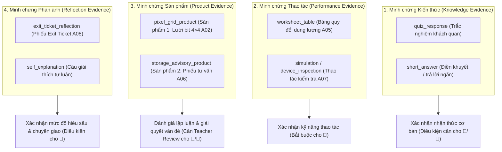

# QUY TẮC ĐÁNH GIÁ MỨC ĐỘ THÀNH THẠO (MASTERY RULES)
## MÔ HÌNH ĐÁNH GIÁ DỰA TRÊN MINH CHỨNG THEO YÊU CẦU CẦN ĐẠT
### TÀI LIỆU THIẾT KẾ PHASE 4A-R2 (P4.2 REVISION 2) — DESIGN ONLY / NO ENGINE CODE

> **Mã tài liệu:** `DOC-P4-MASTERY-RULES-01` (Bản sửa đổi R2)  
> **Trạng thái:** `PROPOSAL_DESIGN` (Chỉ dùng cho đặc tả thiết kế, chưa triển khai mã nguồn Engine)  
> **Áp dụng cho:** Bài học mẫu `G6-L03` (*Bài 3. Thông tin trong máy tính* — 2 tiết / 90 phút)  
> **Căn cứ nguồn chuẩn:** [requirements-g6.json](file:///Users/huynhvandien/tinhocthaydien/data/requirements/requirements-g6.json), [G6-L03.golden.json](file:///Users/huynhvandien/tinhocthaydien/data/lessons/G6-L03.golden.json), [PHASE3_TRACEABILITY_REPORT.md](file:///Users/huynhvandien/tinhocthaydien/PHASE3_TRACEABILITY_REPORT.md).

---

## 1. NGUYÊN TẮC CỐT LÕI (CORE PHILOSOPHY)

1. **Đánh giá theo từng Yêu cầu cần đạt (Requirement-Centered Evaluation):**
   - Mức độ thành thạo (Mastery) được tính toán độc lập cho **từng `RequirementID` riêng biệt** (`G6-A-07`, `G6-A-08`, `G6-A-09`, `G6-A-10`).
   - **TUYỆT ĐỐI KHÔNG ĐƯỢC TÍNH TOÁN BẰNG:**
     - Tỉ lệ hoàn thành bài học (ví dụ: `percentComplete = 100%` chỉ phản ánh việc hoàn thành các bước, không đồng nghĩa với đạt mức thành thạo cao nhất).
     - Tổng điểm trắc nghiệm (ví dụ: `8/10` điểm quiz không thể kết luận học sinh đạt yêu cầu nếu thiếu sản phẩm thực hành bắt buộc).
     - Số lượng hoạt động đã mở hoặc thời gian ngồi trước màn hình.
2. **Minh chứng là căn cứ duy nhất (Evidence-Based Decision):**
   - Không có minh chứng hợp lệ = Không thể cấp mức đạt yêu cầu.
   - Minh chứng phải đa dạng, bao hàm từ nhận thức đến thao tác thực hành và giải thích lập luận.

---

## 2. BỐN MỨC ĐỘ THÀNH THẠO CHUẨN (4 MASTERY LEVELS)

Hệ thống sử dụng biểu tượng trực quan giàu tính sư phạm kết hợp với mã máy chuẩn hóa (Machine Codes) không đổi:

| Biểu tượng sư phạm | Tên gọi chuẩn | Mã máy chuẩn (Machine Code) | Định nghĩa sư phạm | Thông điệp hiển thị cho học sinh (Student-Facing Message) |
|---|---|---|---|---|
| 🌱 | **Chưa đủ minh chứng** | `insufficient_evidence` | Chưa có dữ liệu, thiếu minh chứng bắt buộc của YCCĐ, hoặc minh chứng mâu thuẫn mạnh cần kiểm tra thêm. | *"Mình cần thêm một vài minh chứng để biết em đã hiểu phần này đến đâu."* |
| 🌿 | **Đang hình thành** | `developing` | Đã có minh chứng hợp lệ nhưng chưa ổn định, cần sự trợ giúp đáng kể từ Support Ladder, còn nhầm lẫn nhỏ, hoặc chưa vận dụng được. | *"Em đang tiến bộ rất tốt! Hãy luyện tập thêm một chút để nắm thật vững nhé."* |
| 🌳 | **Đạt yêu cầu** | `meets_requirement` | Hoàn thành đầy đủ mọi minh chứng bắt buộc của YCCĐ; không còn quan niệm sai lầm cốt lõi; minh chứng mở (nếu có) đã được thẩm định đạt. | *"Chúc mừng em đã làm chủ trọn vẹn mục tiêu học tập này!"* |
| 🚀 | **Vận dụng mở rộng** | `transfer_extension` | Đã đạt mức 🌳 VÀ tạo ra minh chứng chuyển giao (transfer evidence) trong tình huống thực tế mới; giải thích lập luận sâu sắc được giáo viên phê duyệt. | *"Xuất sắc! Em đã biết vận dụng kiến thức linh hoạt vào các tình huống thực tế mới."* |

---

## 3. PHÂN TẦNG MINH CHỨNG (EVIDENCE HIERARCHY)

Không phải mọi minh chứng đều có trọng số và vai trò như nhau. Hệ thống chia thành 4 nhóm minh chứng:



1. **Minh chứng Kiến thức (Knowledge Evidence):**
   - Vai trò: Kiểm tra khả năng nhận biết khái niệm, ghi nhớ thuật ngữ, định danh các thành phần.
   - Mức tối đa có thể đạt độc lập: **🌿 Đang hình thành**. Một câu trắc nghiệm đơn lẻ không bao giờ đủ để cấp 🌳 Đạt yêu cầu nếu YCCĐ đó yêu cầu năng lực giải thích hoặc vận dụng.
2. **Minh chứng Thao tác (Performance Evidence):**
   - Vai trò: Chứng minh học sinh biết thực hiện hành vi cụ thể (tự nhập số quy đổi gần đúng, thao tác nhấp chuột kiểm tra dung lượng ổ đĩa).
   - Là điều kiện tiên quyết cho mức **🌳 Đạt yêu cầu** ở các YCCĐ thực hành (`G6-A-09`, `G6-A-10`).
3. **Minh chứng Sản phẩm (Product Evidence):**
   - Vai trò: Minh chứng chất lượng cao nhất về năng lực tích hợp của học sinh (Sản phẩm 1 biểu diễn bit; Sản phẩm 2 tư vấn lưu trữ).
   - Bắt buộc phải qua cơ chế thẩm định giáo viên (Teacher Review) nếu chứa phần lập luận tự luận mở.
4. **Minh chứng Phản ánh (Reflection Evidence):**
   - Vai trò: Ghi nhận khả năng tự đánh giá mức độ hiểu, tự nhận diện điểm chưa rõ và đề xuất giải pháp cho tình huống mở (Exit Ticket 6 GB).
   - Là căn cứ cốt lõi để nâng cấp từ **🌳 Đạt yêu cầu** lên **🚀 Vận dụng mở rộng**.

---

## 4. NGUYÊN TẮC RA QUYẾT ĐỊNH THÀNH THẠO (DECISION PRINCIPLES)

### 4.1. Giới hạn của Hoạt động Chẩn đoán (Diagnostic Limitation)
- Kết quả từ hoạt động "Khám phá điểm xuất phát" (Phase 4.1) **TUYỆT ĐỐI KHÔNG ĐƯỢC** trực tiếp quyết định mức `🌳 Đạt yêu cầu` hay `🚀 Vận dụng mở rộng`.
- Diagnostic chỉ tạo ra:
  - Trạng thái minh chứng giả định ban đầu (`tentative evidence state`).
  - Gợi ý cấu hình lộ trình học tập (`learning path profile`).
  - Dự báo vùng cần can thiệp sư phạm.

### 4.2. Xử lý câu trả lời mở và thẩm định của giáo viên (Open Response Policy)
- Khi học sinh nộp sản phẩm có phần tự luận giải thích mở (Sản phẩm 1 ở A02, Sản phẩm 2 ở A06):
  - Bản ghi minh chứng được lưu trữ với:
    ```json
    {
      "evaluationStatus": "needs_teacher_review",
      "isCorrect": null,
      "score": null
    }
    ```
  - **Quy tắc chặn tự động (Auto-award prohibition):** Hệ thống không được phép tự động gán `isCorrect = true` hay full điểm cho câu trả lời tự luận mở chỉ vì học sinh điền đủ ký tự.
  - **Điều kiện đạt 🌳 hoặc 🚀:** Nếu một YCCĐ đòi hỏi năng lực giải thích hoặc lập luận (như `G6-A-07` và `G6-A-10`), học sinh chỉ có thể được chốt mức `🌳 Đạt yêu cầu` hoặc `🚀 Vận dụng mở rộng` sau khi giáo viên đã xem xét và chấp thuận minh chứng mở này trong Teacher Mode.

### 4.3. Xử lý nhiều lần thử và thang hỗ trợ (Multiple Attempts & Support Ladder)
- Hệ thống không đánh giá học sinh chỉ dựa trên lần thử đầu tiên (First attempt bias), cũng không chỉ lấy điểm cao nhất duy nhất (Best score illusion).
- Dữ liệu lịch sử lần thử được lưu trữ đầy đủ:
  - Số lần thử (`attemptNumber`).
  - Các nấc hỗ trợ đã sử dụng (`supportTierUsed: 1, 2, 3`).
  - Quỹ đạo sửa sai (Error resolution trajectory).
- **Quy tắc phân cấp:**
  - Nếu học sinh trả lời đúng ngay lần đầu hoặc lần 2 với gợi ý nhỏ (Tier 1): Đủ điều kiện xét **🌳 Đạt yêu cầu**.
  - Nếu học sinh phải dùng đến gợi ý chi tiết (Tier 3: Xem bài mẫu tương tự) mới làm đúng: Tạm thời xếp ở mức **🌿 Đang hình thành**, cần thêm 1 câu hỏi kiểm tra độ ổn định độc lập để xét 🌳.

### 4.4. Xử lý minh chứng mâu thuẫn (Conflicting Evidence Policy)
- Trường hợp học sinh trả lời đúng câu hỏi trắc nghiệm nhưng sản phẩm thực hành hoặc câu giải thích tự luận lại bộc lộ hiểu sai bản chất:
  - Hệ thống ghi nhận cờ **`conflicting_evidence`**.
  - **TUYỆT ĐỐI KHÔNG CẤP 🌳 ĐẠT YÊU CẦU**.
  - Trạng thái được giữ ở mức **🌿 Đang hình thành** và gửi thông báo `REVIEW_REQUIRED` lên bảng điều khiển của giáo viên.

---

## 5. VÍ DỤ MINH CHỨNG CỤ THỂ CHO BÀI 3 (`G6-L03`)

### 5.1. YCCĐ `G6-A-07`: *Giải thích được có thể biểu diễn thông tin chỉ với hai kí hiệu 0 và 1.*
- **Minh chứng yêu cầu (Structured Evidence References):**
  - Sản phẩm 1: `G6-L03-PROD-01` (Lưới bit 4×4 tạo thành chữ T: `1111 0100 0100 0100` + Câu giải thích số 0 đại diện cho ô trắng và số 1 đại diện cho ô được tô màu).
  - Câu hỏi nhận thức: `G6-L03-Q001`, `G6-L03-Q002` (tại Hoạt động A01 và A02).
  - Minh chứng củng cố: `G6-L03-Q004` (tại Hoạt động A04).
- **Phân loại 4 mức:**
  - 🌱 **Chưa đủ minh chứng:** Chưa thao tác trên lưới bit, hoặc chuỗi bit không khớp hình vẽ và bỏ trống câu giải thích.
  - 🌿 **Đang hình thành:** Tạo được hình chữ T nhưng câu giải thích chỉ viết chung chung "đây là chữ T" mà không nêu được vai trò của 0 và 1; hoặc trả lời sai câu hỏi Q002 về nguyên lý biểu diễn.
  - 🌳 **Đạt yêu cầu:** Tạo đúng chuỗi 16 bit chữ T; viết được câu giải thích rõ ràng "Số 0 biểu diễn ô không tô màu và số 1 biểu diễn ô được tô màu trên lưới"; trả lời đúng Q001, Q002, Q004; giáo viên thẩm định đạt Sản phẩm 1.
  - 🚀 **Vận dụng mở rộng:** Đạt mức 🌳 VÀ giải thích được cách mở rộng biểu diễn: ví dụ tự mã hóa thêm một chữ cái khác (chữ H, chữ L) bằng ma trận bit, hoặc giải thích được nguyên lý biểu diễn ảnh đen trắng có kích thước lớn hơn trong thực tế.

---

### 5.2. YCCĐ `G6-A-08`: *Biết được bit là đơn vị nhỏ nhất trong lưu trữ thông tin.*
- **Minh chứng yêu cầu (Structured Evidence References):**
  - Câu hỏi nhận thức: `G6-L03-Q003` (tại Hoạt động A03), `G6-L03-Q005` (tại Hoạt động A04).
  - Sự nhất quán trong câu giải thích Sản phẩm 1 (`G6-L03-PROD-01`).
- **Phân loại 4 mức:**
  - 🌱 **Chưa đủ minh chứng:** Bỏ qua câu hỏi hoặc chọn nhầm Byte/MB là đơn vị nhỏ nhất.
  - 🌿 **Đang hình thành:** Nhận biết bit nhận giá trị 0 hoặc 1 nhưng còn lúng túng khi so sánh kích thước giữa bit và Byte (ví dụ nhầm 1 bit = 8 byte).
  - 🌳 **Đạt yêu cầu:** Trả lời chính xác và nhất quán trong cả Q003 và Q005 rằng bit là đơn vị nhỏ nhất trong lưu trữ thông tin, mỗi bit chỉ nhận một trong hai trạng thái 0 hoặc 1.
  - 🚀 **Vận dụng mở rộng:** Đạt mức 🌳 VÀ liên hệ được vì sao bit là đơn vị nhỏ nhất với cơ chế vật lý của thiết bị điện tử (trạng thái đóng/ngắt công tắc điện, có/không có điện tích).

---

### 5.3. YCCĐ `G6-A-09`: Đối soát toàn diện 3 Chiều kích YCCĐ & Khai báo Khoảng trống Minh chứng
Nội dung văn bản chính thức CTGDPT 2018 của `G6-A-09` gồm ba vế bắt buộc:
> *"Nêu được tên và độ lớn (xấp xỉ theo hệ thập phân) của các đơn vị cơ bản đo dung lượng thông tin: Byte, KB, MB, GB, quy đổi được một cách gần đúng giữa các đơn vị đo lường này. Ví dụ: 1 KB bằng xấp xỉ 1 ngàn byte, 1 MB xấp xỉ 1 triệu byte, 1 GB xấp xỉ 1 tỉ byte."*

Hệ thống thiết kế bảng đối chiếu minh chứng cụ thể cho từng chiều kích:

| Chiều kích YCCĐ (Dimension) | Nội dung cần đạt | Minh chứng đảm nhiệm trong Golden Lesson `G6-L03` | Trạng thái minh chứng (Coverage Status) | Đánh giá năng lực độc lập |
|---|---|---|:---:|---|
| **1. `unit_names`** *(Tên đơn vị)* | Nêu được tên các đơn vị cơ bản: Byte, KB, MB, GB. | - `G6-L03-Q006` (Trắc nghiệm quan hệ GB ↔ MB).<br/>- `G6-L03-WS-01` (Bảng quy đổi in sẵn nhãn "1 KB", "byte", "1 MB", "KB", "1 GB", "MB", học sinh chỉ gõ số).<br/>- `G6-L03-PROD-02` (Chọn thiết bị có nhãn sẵn trong danh mục). | **`evidence_gap`**<br/>(Chưa đủ điều kiện cấp Mastery) | **Khoảng trống minh chứng:** Việc nhìn thấy nhãn đơn vị có sẵn trên giao diện (seeing a unit label) **KHÔNG ĐỒNG NGHĨA** với việc học sinh tự lực độc lập nêu được tên 4 đơn vị cơ bản (Byte, KB, MB, GB). Cần có minh chứng độc lập không in sẵn đáp án. |
| **2. `decimal_approximation`** *(Độ lớn xấp xỉ hệ thập phân)* | Nêu được độ lớn xấp xỉ theo hệ thập phân (1 KB ≈ 1000 Byte, 1 MB ≈ 1000 KB, 1 GB ≈ 1000 MB). | - `G6-L03-WS-01` (Học sinh tự gõ số `1000` vào cả 3 ô `#ws-kb-byte`, `#ws-mb-kb`, `#ws-gb-mb`).<br/>- `G6-L03-Q006` (Khẳng định quan hệ gấp xấp xỉ 1000 lần giữa các đơn vị liền kề). | **`covered`**<br/>(Đã bao phủ đầy đủ) | Minh chứng vững chắc: Học sinh tự gõ giá trị số `1000` vào bảng quy đổi và chọn đúng bội số xấp xỉ 1000 lần. |
| **3. `approximate_conversion`** *(Quy đổi gần đúng)* | Quy đổi được một cách gần đúng giữa các đơn vị đo lường này. | - `G6-L03-WS-01` (Quy đổi hoàn chỉnh giữa các bậc dung lượng).<br/>- `G6-L03-Q007` (Tính toán quy đổi 3 xấp văn bản x 1000 KB = 3000 KB).<br/>- `G6-L03-Q008` (So sánh dung lượng 2 GB với tệp 3 GB).<br/>- `G6-L03-PROD-02` (Ước lượng tổng nhu cầu ~6 GB = xấp xỉ 6000 MB để chọn thiết bị). | **`covered`**<br/>(Đã bao phủ đầy đủ) | Minh chứng vững chắc: Học sinh tính toán quy đổi gần đúng chính xác và vận dụng vào bài toán tư vấn lưu trữ thực tế. |

#### A. Khai báo khoảng trống thiết kế cấu trúc (Explicit Structured Design Gap)
- **Mã khoảng trống (Gap Code):** `G6_A09_UNIT_NAMES_EVIDENCE_GAP`
- **Chiều kích bị ảnh hưởng:** `unit_names`
- **Mức độ nghiêm trọng:** `mastery_blocking` (Chặn cấp chuẩn thành thạo)
- **Mô tả:** Minh chứng hiện tại của `G6-L03` hiển thị Byte, KB, MB, GB chủ yếu dưới dạng nhãn in sẵn; học sinh chỉ thao tác nhập số hoặc chọn phương án trắc nghiệm quan hệ cục bộ giữa GB và MB, chưa có hoạt động nào độc lập yêu cầu học sinh tự nêu/viết đủ 4 đơn vị cơ bản.
- **Rào cản thành thạo (Mastery Blocking Rules):**
  - `blocksMeetsRequirement = true` (Chặn không cho cấp mức 🌳 Đạt yêu cầu).
  - `blocksTransferExtension = true` (Chặn không cho cấp mức 🚀 Vận dụng mở rộng).
  - `maximumAutomatedMastery = "developing"` (Mức thành thạo tối đa trước khi khắc phục khoảng trống là 🌿 Đang hình thành).

#### B. Quy tắc an toàn thành thạo (Mastery Safety Rule)
1. **Tuyệt đối không cấp 🌳 / 🚀 khi chưa giải quyết Gap:** Chừng nào khoảng trống `G6_A09_UNIT_NAMES_EVIDENCE_GAP` chưa được bổ sung minh chứng độc lập được phê duyệt, hệ thống đánh giá năng lực **KHÔNG ĐƯỢC TỰ ĐỘNG CẤP MỨC 🌳 ĐẠT YÊU CẦU HOẶC 🚀 VẬN DỤNG MỞ RỘNG** cho YCCĐ `G6-A-09`, ngay cả khi học sinh làm đúng 100% các câu hỏi hiện có (`WS-01`, `Q006`, `Q007`, `Q008`) và tiến độ bài học đạt 100%.
2. **Bảo tồn giá trị minh chứng hợp lệ (Do Not Throw Away Valid Evidence):** Không đánh đồng việc thiếu minh chứng `unit_names` với việc học sinh hoàn toàn chưa biết gì. Các minh chứng học sinh đã làm tốt ở `decimal_approximation` và `approximate_conversion` vẫn được ghi nhận ở trạng thái `ready_evidence`. Hệ thống lưu trữ trạng thái năng lực ở cấp độ chiều kích (dimension-level state):
   - `dimensions.unit_names.status = "evidence_gap"`
   - `dimensions.decimal_approximation.status = "ready_evidence"`
   - `dimensions.approximate_conversion.status = "ready_evidence"`
   - `mastery = "developing"` (với `masteryBlockedBy = ["unit_names"]`).
3. **Tách biệt Tiến độ hoàn thành bài học và Chuẩn năng lực (Lesson Completion vs Competency Mastery):** Học sinh hoàn thành 100% các hoạt động A01–A08 của bài học thì tiến độ bài học (Lesson Completion) vẫn đạt 100%. Tuy nhiên, mức chuẩn năng lực (Competency Mastery) của riêng YCCĐ `G6-A-09` tạm dừng an toàn ở mức 🌿 `developing` do rào cản minh chứng `unit_names`.

#### C. Đề xuất minh chứng tương lai tối thiểu (Minimal Future Evidence Design Proposal)
> **NGUYÊN TẮC QUẢN TRỊ:** Đây là bản đề xuất thiết kế (DESIGN PROPOSAL ONLY). **TUYỆT ĐỐI KHÔNG** tự ý thêm câu hỏi này vào mã nguồn `G6-L03.golden.json` hoặc giao diện bài học trong Phase 4A-R2. Project Controller sẽ quyết định thời điểm và phương thức phê duyệt triển khai.

- **Mã đề xuất tạm thời (Provisional ID):** `PROVISIONAL-G6-L03-E-NAMES`
- **YCCĐ mục tiêu:** `G6-A-09` (Chiều kích: `unit_names`)
- **Dạng thức minh chứng:** Điền khuyết 4 trường độc lập không điền sẵn (Short answer / 4 blank fields).
- **Ý định nhận thức (Cognitive Intent):** Yêu cầu học sinh tự lực viết tên hoặc kí hiệu của 4 đơn vị cơ bản đo dung lượng thông tin theo thứ tự từ nhỏ đến lớn mà không nhìn thấy gợi ý sẵn.
- **Nội dung lệnh hỏi (Prompt Intent):** *"Hãy viết tên hoặc kí hiệu của bốn đơn vị cơ bản đo dung lượng thông tin từ nhỏ đến lớn."*
- **Giao diện phản hồi dự kiến (Expected Student Interaction):**
  - Đơn vị 1 (nhỏ nhất): `[________]` (Kỳ vọng: `Byte` hoặc `B`)
  - Đơn vị 2: `[________]` (Kỳ vọng: `Kilobyte` hoặc `KB`)
  - Đơn vị 3: `[________]` (Kỳ vọng: `Megabyte` hoặc `MB`)
  - Đơn vị 4 (lớn nhất): `[________]` (Kỳ vọng: `Gigabyte` hoặc `GB`)
  *(Hoàn toàn KHÔNG in sẵn chữ Byte, KB, MB, GB trong các ô nhập hoặc nhãn kế bên).*
- **Khả năng chấm tự động (Auto-grade Feasibility):** Khả thi cao. Hệ thống chuẩn hóa chuỗi (trim, lowercase, chấp nhận cả tên đầy đủ tiếng Anh/Việt hoặc ký hiệu viết tắt chuẩn: `byte`/`b`, `kilobyte`/`kb`, `megabyte`/`mb`, `gigabyte`/`gb`).

#### D. Rà soát đối chiếu các YCCĐ khác của Bài 3 (`G6-A-07`, `G6-A-08`, `G6-A-10`)
Đã thực hiện rà soát độc lập toàn diện để đảm bảo không xảy ra hiện tượng overclaim tương tự ở các YCCĐ còn lại:
- `G6-A-07` (*Biểu diễn 0 và 1*): Có Sản phẩm 1 (`G6-L03-PROD-01`) học sinh tự tạo hình chữ T 4×4 kèm câu tự luận giải thích số 0 và 1 biểu diễn điều gì, được giáo viên thẩm định thủ công (`teacherReviewRequired: true`). Minh chứng đầy đủ, `designGap: null`.
- `G6-A-08` (*Bit là đơn vị nhỏ nhất*): Có 2 câu hỏi nhận thức độc lập: Q003 (trắc nghiệm đơn vị nhỏ nhất) và Q005 (tự luận ngắn giải thích giá trị bit). Minh chứng đầy đủ, `designGap: null`.
- `G6-A-10` (*Khả năng lưu trữ thiết bị nhớ*): Có Sản phẩm 2 (`G6-L03-PROD-02`) tự chọn thiết bị kèm lập luận tính toán, câu hỏi Q010 đọc dung lượng thực tế, và phiếu Exit Ticket so sánh thiết bị. Minh chứng đầy đủ, `designGap: null`.

---

### 5.4. YCCĐ `G6-A-10`: *Nêu được sơ lược khả năng lưu trữ của các thiết bị nhớ thông dụng như đĩa cứng, USB, CD, thẻ nhớ,...*
- **Minh chứng yêu cầu (Structured Evidence References — Không dùng bare ActivityID):**
  - Sản phẩm 2: `G6-L03-PROD-02` (Phiếu tư vấn lưu trữ gồm 4 trường: Nhu cầu, Dung lượng ước lượng ~6 GB, Thiết bị lựa chọn, Lí do lựa chọn logic tại Hoạt động A06).
  - Khám phá thiết bị nhớ: `G6-L03-Q010` (tại Hoạt động `G6-L03-A07`, thực hiện sau khi xem dung lượng qua `REAL_DEVICE` hoặc `SIMULATION`).
  - Phiếu Exit Ticket: Minh chứng tự phản ánh tại Hoạt động `G6-L03-A08` (`evidenceType: "exit_ticket_reflection"`, câu hỏi vận dụng thực tế phương án lưu 6 GB dữ liệu).
- **Phân loại 4 mức:**
  - 🌱 **Chưa đủ minh chứng:** Chưa nộp Sản phẩm 2 hoặc chưa hoàn thành câu hỏi Q010.
  - 🌿 **Đang hình thành:** Kể được tên các thiết bị nhưng chọn phương án dung lượng không hợp lí (ví dụ: chọn CD 700 MB hoặc USB 4 GB để mang 6 GB dữ liệu); lý do lập luận sơ sài không căn cứ vào dung lượng.
  - 🌳 **Đạt yêu cầu:** Hoàn thành Sản phẩm 2 chọn đúng thiết bị có dung lượng lớn hơn 6 GB (USB 16 GB, Thẻ nhớ 32 GB, Ổ cứng 500 GB) với lập luận logic (16 GB > 6 GB và nhỏ gọn dễ mang đến trường); thực hiện đúng thao tác đọc dung lượng ở A07 (Q010); giáo viên thẩm định duyệt đạt Sản phẩm 2.
  - 🚀 **Vận dụng mở rộng:** Đạt mức 🌳 VÀ đưa ra giải pháp tư vấn đa chiều trong câu hỏi Exit Ticket: So sánh được ưu nhược điểm giữa các phương án (ví dụ: chọn USB 16 GB vì tính di động hàng ngày, nhưng đề xuất dùng thêm Ổ cứng ngoài để sao lưu dài hạn tại nhà).

---

## 6. BẢNG MA TRẬN QUY TẮC ĐÁNH GIÁ (MASTER RULE TABLE)

Bảng quy chuẩn logic quyết định mức độ thành thạo cho 4 YCCĐ của Bài học mẫu `G6-L03`:

| RequirementID | RequiredEvidence (Cấu trúc minh chứng rõ ràng) | SupportingEvidence (Minh chứng bổ trợ) | TeacherReviewRequired (Bắt buộc GV duyệt) | InsufficientRule (🌱 Chưa đủ minh chứng) | DevelopingRule (🌿 Đang hình thành) | MeetsRule (🌳 Đạt yêu cầu) | ExtensionRule (🚀 Vận dụng mở rộng) | ConflictRule (Quy tắc xử lý mâu thuẫn) |
|---|---|---|:---:|---|---|---|---|---|
| **`G6-A-07`** *(Biểu diễn 0 và 1)* | `evidenceId: G6-L03-PROD-01`<br/>`evidenceId: G6-L03-Q001`<br/>`evidenceId: G6-L03-Q002` | `G6-L03-Q004`, Diagnostic Probe 6 | **CÓ** (Duyệt Sản phẩm 1) | Thiếu PROD-01 hoặc Q001/Q002 chưa làm. | Chuỗi bit đúng nhưng giải thích 0/1 chưa rõ, hoặc cần gợi ý Tier 2/3. | PROD-01 chuỗi bit chuẩn + câu giải thích đúng + Q001/Q002 đúng + GV duyệt đạt. | Đạt 🌳 + biểu diễn được ký tự mới hoặc giải thích mở rộng ảnh số. | Q001 đúng nhưng PROD-01 vẽ sai hoặc giải thích sai -> Giữ ở 🌿, gắn cờ `REVIEW_REQUIRED`. |
| **`G6-A-08`** *(Bit là đơn vị nhỏ nhất)* | `evidenceId: G6-L03-Q003`<br/>`evidenceId: G6-L03-Q005` | PROD-01 bit logic, Diagnostic Probe 6 | **KHÔNG** (Trắc nghiệm khách quan) | Thiếu cả Q003 và Q005. | Đúng 1 trong 2 câu nhưng còn phân vân, cần thử lại lần 2. | Đúng cả Q003 và Q005 khẳng định bit là đơn vị nhỏ nhất. | Đạt 🌳 + giải thích được mối liên hệ giữa bit và trạng thái vật lý thiết bị. | Q003 chọn bit nhưng Q005 lại chọn Byte -> Giữ ở 🌿. |
| **`G6-A-09`** *(Tên, độ lớn xấp xỉ & quy đổi Byte/KB/MB/GB)* | `evidenceId: G6-L03-WS-01`<br/>`evidenceId: G6-L03-Q006`<br/>`evidenceId: G6-L03-Q007` | `G6-L03-Q008`, Diagnostic Probe 7 | **KHÔNG** (Tự động chấm theo bảng số) | Bảng WS-01 chưa điền hoặc sai cả 3 ô; hoặc để trống toàn bộ bài tập quy đổi. | Đã đạt `decimal_approximation` (WS-01 gõ 1000) và `approximate_conversion` (Q007 đúng) nhưng chiều kích `unit_names` bị thiếu minh chứng độc lập (`G6_A09_UNIT_NAMES_EVIDENCE_GAP`). Mức tối đa hiện tại dừng ở 🌿. | Yêu cầu cả 3 chiều kích (`unit_names`, `decimal_approximation`, `approximate_conversion`). **HIỆN TẠI BỊ CHẶN BỞI G6_A09_UNIT_NAMES_EVIDENCE_GAP (UNIT_NAMES_EVIDENCE_REQUIRED)** cho đến khi có minh chứng độc lập của `unit_names`. | Đòi hỏi phải đạt 🌳 trước + giải quyết bài toán quy đổi đa bước trong tình huống mới. **Hiện tại bị chặn theo mức 🌳.** | Thuộc vẹt thứ tự độ lớn ở Q006 nhưng tính toán quy đổi sai ở Q007 -> Giữ ở 🌿. Hoàn thành 100% bài học nhưng thiếu minh chứng unit_names -> Tạm dừng ở 🌿. |
| **`G6-A-10`** *(Khả năng lưu trữ thiết bị nhớ)* | `evidenceId: G6-L03-PROD-02`<br/>`evidenceId: G6-L03-Q010 (tại A07)`<br/>`activityId: G6-L03-A08 (Exit Ticket)` | `G6-L03-Q009`, Diagnostic Probe 8 | **CÓ** (Duyệt Sản phẩm 2) | Thiếu PROD-02 hoặc chưa nộp Exit Ticket. | Chọn thiết bị dung lượng nhỏ hơn nhu cầu (< 6 GB), hoặc lý do không logic. | PROD-02 chọn đúng thiết bị ≥ 6 GB kèm lý do logic + Q010 đúng + GV duyệt đạt. | Đạt 🌳 + so sánh toàn diện ưu nhược điểm các thiết bị trong Exit Ticket. | Q009 chọn đúng USB nhưng PROD-02 lại chọn CD 700 MB cho 6 GB -> Giữ ở 🌿. |

---

## 7. BẢNG TIÊU CHÍ NGHIỆM THU (ACCEPTANCE CHECKLIST P4.2 REVISION 2)

| Tiêu chí | Mô tả yêu cầu | Trạng thái đạt được |
|---|---|---|
| **Đánh giá theo RequirementID** | Không dùng lesson percent hay quiz total score; tính toán độc lập cho `G6-A-07`..`10`. | **ĐẠT (PASS)** |
| **Đủ 4 mức độ chuẩn** | Có đủ 🌱 `insufficient_evidence`, 🌿 `developing`, 🌳 `meets_requirement`, 🚀 `transfer_extension`. | **ĐẠT (PASS)** |
| **Diagnostic không auto-mastery** | Diagnostic không bao giờ cấp mức 🌳 hay 🚀. | **ĐẠT (PASS)** |
| **Thẩm định minh chứng mở** | Sản phẩm mở có `needs_teacher_review` bắt buộc phải qua giáo viên phê duyệt mới được cấp 🌳/🚀. | **ĐẠT (PASS)** |
| **Xử lý minh chứng mâu thuẫn** | Có quy tắc `ConflictRule` ngăn chặn cấp 🌳 khi trắc nghiệm đúng nhưng thực hành/tự luận sai. | **ĐẠT (PASS)** |
| **Đánh giá nhiều lần thử** | Ghi nhận số lần thử và nấc hỗ trợ đã dùng, không chỉ lấy điểm lần đầu hay điểm cao nhất duy nhất. | **ĐẠT (PASS)** |
| **Mức 🚀 đòi hỏi Transfer Evidence** | Mức Vận dụng mở rộng bắt buộc phải có minh chứng chuyển giao thực tiễn, không cấp vì điểm cao hay làm nhanh. | **ĐẠT (PASS)** |
| **G6-A-10 Evidence Structured (Fix 5)** | Không dùng bare ActivityID (`G6-L03-A07`, `G6-L03-A08`) làm EvidenceID; dùng cấu trúc ngữ nghĩa rõ ràng. | **ĐẠT (PASS)** |
| **G6-A-09 Unit Names Evidence Gap (R2)** | Khai báo tường minh `G6_A09_UNIT_NAMES_EVIDENCE_GAP`. Chặn không cho cấp 🌳/🚀 khi thiếu minh chứng độc lập `unit_names`. Mức trần tạm dừng an toàn ở 🌿 `developing`. | **ĐẠT (PASS)** |
| **Đề xuất minh chứng tương lai (R2)** | Có bản thiết kế đề xuất câu hỏi điền khuyết 4 ô độc lập `PROVISIONAL-G6-L03-E-NAMES` không in sẵn đáp án. Không sửa đổi mã nguồn bài học. | **ĐẠT (PASS)** |
